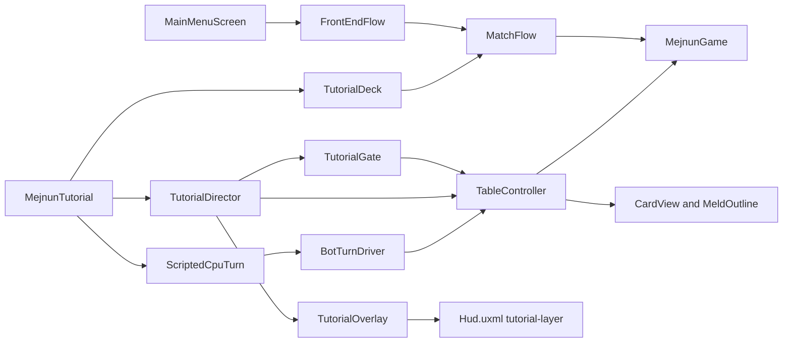

# Requirements

### Overview & Goals
New players get an **interactive, scripted tutorial match** that teaches every rule in `Docs/Mejnun-Plan.md` §1 by having them actually do it. It is **one guided 2-player match** against a single CPU ("Layla"). It uses a **stacked deck**: every card the player and the CPU hold, and every card drawn, is authored. The CPU plays **scripted moves**, so the lesson is identical every time. Popups and modals explain each rule. When the player has to act, the cards to move (and their destination) are highlighted and other moves are blocked.

### Scope
**In scope**
- Tutorial entry points:
  - A **How to play** button on the main menu.
  - A one-time "New to Mejnun? Play the tutorial" prompt the first time Play is pressed.
- A fixed 2-seat match (You vs Layla): stacked deck, untimed, hints off.
- A step-by-step script covering:
  - valid sets (same kind, straights), ace low/high and no wrap-around;
  - doubles;
  - the Not down → Down rules and going down then continuing the same turn;
  - extending, splitting, and taking from a 4-card same-kind set;
  - temporary invalid groups and End-turn gating;
  - Undo/Redo, Draw, the last-card warning, and winning with MEJNUN!.
- UI pieces:
  - **Coach popup**: a non-blocking speech bubble with Next / Skip.
  - **Rule modal**: a blocking card with a mini card-diagram and Got it.
  - **Focus highlight**: a pulsing outline on the cards to move and the drop target, other cards dimmed, and an animated ghost-hand hint.
  - **Button focus** on HUD buttons.
- Soft correction when the player does something off-script: the card springs back and the popup shows "Try the highlighted cards".
- Skip / Quit tutorial at any time (from the pause menu). Completion is remembered in the profile.
- The closing **"Good to know" modal** for rules we can't stage cheaply: empty draw pile → Pass, Stalemate, Timed mode/Halas!, Fix board, Revert, hints, pinch/zoom, and "winner goes first".

**Out of scope**
- Online and pass-and-play tutorials.
- Localization of the tutorial strings (they are authored in English as plain strings, ready for the M9 String Tables).
- XP, stats, achievements or a saved game for the tutorial match.
- Voice-over.

### User Stories
- As a new player, I want to be shown which cards to move, so I learn by playing instead of reading.
- As a new player, I want every rule explained at the moment it matters, so I'm not overwhelmed up front.
- As a returning player, I want to replay or skip the tutorial at any time.

### Tutorial flow (what the player sees)
Seats: **You (seat 0)** and **Layla (seat 1, CPU)**. Layla takes the first turn, so the board already has a set when you start. Notation: `9♥′` is the second-deck copy (a double).

| # | Who | What happens | Rule taught | Player interaction |
|---|---|---|---|---|
| 0 | — | **Welcome modal**: two decks (104 cards), 11 each, empty your hand to win. **Sets modal**: same kind (3–4, all suits different) and straight (3+, one suit, in order) | Components, objective, valid sets | Got it |
| C1 | Layla | Plays `J♠ Q♠ K♠`. Popup: "Layla is **Down**: she put down a set made only from her hand" | Going down; one set is enough | Watch |
| H1a | You | Popup: "You're not down yet. Try putting `A♠` on Layla's set." `A♠` and the J-Q-K♠ set are highlighted; the drop is rejected | **Not down** players can't touch the board | Drag (expected to fail) |
| H1b | You | Highlight `7♥ 8♥ 9♥` + empty area → straight → auto go-down, "Gone Down" popup. **Modal**: now you can use the whole board, this same turn | Go down from hand only, then keep playing | Drag / tap-select |
| H1c | You | Highlight `A♠` → J-Q-K♠ becomes `J-Q-K-A♠`. **Modal**: an ace is low (A-2-3) or high (Q-K-A), never K-A-2 | Ace high, no wrap | Drag |
| H1d | You | Highlight `5♣ 5♦ 5♠` → new set | Same kind | Tap-select + tap empty |
| H1e | You | Highlight `9♥′` and the board `9♥`. **Modal**: a double has the same suit and rank from the other deck (different card face); it can't go in the same set | Doubles | Got it |
| H1f | You | Highlight **End turn**. Popup: you need a valid board plus at least one card from your hand | End-turn rule | Tap End turn |
| C2 | Layla | Adds `10♥ J♥` to your hearts → `7…J♥`; adds `5♥` to the 5s (four of a kind). Popup: "Once you're down, you can add to *any* set" | Extending sets | Watch |
| H2a | You | Long-press `10♥` in `7…J♥`; the tail `10♥ J♥` lifts out to the empty area and gets a **red outline**. Popup: invalid groups are fine mid-turn, but End turn stays disabled | Splitting a straight; temporary invalid sets | Long-press drag |
| H2b | You | Highlight `9♥′` → onto `10♥ J♥` → `9♥′ 10♥ J♥` valid, `7 8 9♥` still valid | Using a double in a different set | Drag |
| H2c | You | Highlight **Undo**, then **Redo**. Popup: Undo steps back; Revert resets the turn; Fix board repairs it | Safety net | Tap Undo, tap Redo |
| H2d | You | End turn | — | Tap |
| C3 | Layla | Can't play → **Draws**. Popup: drawing takes one card and ends your turn | Draw / Pass | Watch |
| H3a | You | Highlight `3♥ 4♥` → new group (red). Then highlight `5♥` in the four 5s → onto it → `3♥ 4♥ 5♥`; the 5s stay valid with 3 cards | Taking from a 4-card same kind | Tap-select, drag |
| H3b | You | End turn → you have 1 card left: the shake + **!** warning. Popup: everyone can see you're about to win | Last-card warning | Tap |
| C4 | Layla | Plays a new straight `7♦ 8♦ 9♦` | Down players can also start new sets | Watch |
| H4 | You | Popup: "`A♥` doesn't fit anywhere." Highlight **Draw**. Popup: Draw also returns any cards you placed this turn | Drawing when stuck | Tap Draw |
| C5 | Layla | Draws | — | Watch |
| H5 | You | Highlight `2♥` → `2-3-4-5♥`, then `A♥` → `A-2-3-4-5♥`. **Ace low**. Your hand is empty → **MEJNUN!** | Ace low, winning | Drag ×2 |
| End | — | **"Good to know" modal** (paged): empty pile → Pass; everyone passes → fewest cards wins, a tie is a Stalemate; timed turns and Halas!; Fix board vs Revert; hints; pinch/zoom/fit; winner goes first next game. Then the results screen with **Play for real** / **Menu** | Remaining rules | Next / Done |

### Functional Requirements
- The deal is identical on every run.
  - You: `7♥ 8♥ 9♥ 5♣ 5♦ 5♠ A♠ 9♥′ 3♥ 4♥ A♥`.
  - Layla: `J♠ Q♠ K♠ 10♥ J♥ 5♥ 7♦ 8♦ 9♦ 2♣ 6♠`.
  - Draw pile top-down: Layla's junk card (`Q♦`), `2♥`, a junk card, then filler.
- During a focus step:
  - Only the highlighted gesture or button is accepted. Any other command is rejected without changing state, with an invalid haptic/sound and a nudge.
  - Pan, zoom, fit, hand reordering and sorting are always allowed.
- A step completes on the **resulting board/hand state**, not on a specific gesture, so tap-select and drag both work.
- Popups never cover the highlighted cards; they anchor above the hand or beside the target set.
- The tutorial doesn't save a resumable game, record a `MatchSummary`, or award XP.
- Finishing or skipping sets `TutorialCompleted`. After that, the first-Play prompt no longer appears.
- Esc or the pause menu offers **Skip tutorial** (with confirmation). Reduced-motion turns off the ghost-hand animation and the jiggle.

### Non-Functional Requirements
- Portrait and landscape layouts, and safe areas, reuse the HUD's USS responsive classes.
- No change to normal-match behaviour. The Core change is opt-in, and existing seeds and snapshots stay byte-identical.

# Technical Design

### Current Implementation
- **Engine**:
  - `MejnunGame.StartGame` (`Core/MejnunGame.cs`) shuffles a `Shoe` with `State.Rng`.
  - It deals 11 cards round-robin starting at `dealer + 1`, and the rest go into `DrawPile`. Draws take the **last** element.
  - The first turn goes to `dealer + 1`.
  - `GameSetup` carries the seat count, seed, dealer, timer and cosmetics, but has no way to fix the card order.
- **Match start**:
  - `FrontEndFlow.LaunchMatch(MatchRequest)` → `MatchFlow.StartMatch(MatchRequest)` → `StartRound` → `new MejnunGame(new GameSetup(...))` → `TableController.Initialize`.
  - If a dealer is supplied, the dealer question is skipped.
- **CPU**: `BotTurnDriver.PlayTurn` plans with `BotBrain.PlanTurn` and applies each `GameCommand` through `TableController.ApplyCommand`, with think and step delays.
- **Input**:
  - Every player gesture goes through `TableController.ExecuteGesture` → `ExecuteBatch`. Failures raise `InvalidGesture`.
  - Hint outlines flow through `RefreshHints` → `hintedCardIds` → `CardView.SetHinted`.
- **HUD**: `UI/Uxml/Hud.uxml` has a `popup-layer` (turn/Halas/Gone Down popups) and a `confirm-dialog` modal pattern, both driven by `UI/HudPresenter.cs`.
- **Menu**: `UI/FrontEnd/MainMenuScreen.cs` and `FrontEnd.uxml`.

### Key Decisions
1. **Stacked deck in Core**:
   - `GameSetup` gets an optional `ShoeOrder` (104 unique card ids). `StartGame` uses it instead of `Shoe.Shuffle`.
   - Rationale: exact, readable and robust to RNG/shuffle changes.
   - It is only used at deal time. A snapshot of a started game already contains the hands and pile, so the snapshot format is unchanged.
2. **Scripted CPU through the existing driver**:
   - `BotTurnDriver` gets an optional `IScriptedTurnSource`. When it returns commands for a turn, they replace `BotBrain` but keep the same delays and animations.
   - CPU steps are authored as *intents* ("add these cards to the meld containing card X"). They are resolved to real meld ids at play time, because meld ids are runtime values.
3. **Single tutorial director (state machine)**:
   - `TutorialDirector` (MonoBehaviour, `Mejnun.Game`) walks an ordered list of `TutorialStep`s.
   - Each step declares its UI (popup or modal), focus (cards, target, button), allowed actions and a completion predicate.
   - The predicate is evaluated over `GameState` on `TableController.Synchronized`.
   - Gesture-agnostic predicates keep tap and drag equivalent.
4. **Gating inside `TableController`**:
   - A pluggable `ICommandGate` is checked in `ExecuteBatch` before any engine call.
   - A tutorial focus set drives a new `CardView.SetTutorialFocus/SetDimmed`, separate from the hints, so hints stay untouched.
5. **UI in Mejnun.UI**:
   - `TutorialOverlay` renders coach popups, rule modals and button focus from the director's events.
   - Mejnun.Game never references UI Toolkit, matching the existing `MatchFlow` → `HudPresenter` split.

### Data Models / Contracts
```csharp
// Core/State/GameSetup.cs (added optional parameter, validated: 104 unique ids)
public IReadOnlyList<byte> ShoeOrder { get; }   // null => shuffle as today

// Game/Tutorial/TutorialDeck.cs
public static byte[] Build(int dealer, IReadOnlyList<Card>[] hands, IReadOnlyList<Card> drawsTopFirst);
// interleaves hands in deal order (dealer+1 first), appends filler, puts drawsTopFirst at the end of the shoe

// Game/Tutorial/TutorialStep.cs
public sealed class TutorialStep {
    public string Id; public TutorialUiKind Ui;        // Popup | Modal | None
    public string Title, Body; public TutorialDiagram Diagram; // mini card row for modals
    public byte[] FocusCards; public TutorialTarget Target;    // EmptyBoard | MeldContaining(cardId) | Button(HudButton)
    public TutorialAction Allowed;                      // flags: MoveCards, Split, Undo, Redo, EndTurn, Draw, None
    public Func<GameState, TurnSession, bool> IsComplete;     // null => completes on Next/Got it
    public bool ExpectRejection;                        // H1a: completes on InvalidGesture
}

// Game/Tutorial/ScriptedCpuTurn.cs
public interface IScriptedTurnSource { bool TryGetCommands(MejnunGame game, int seat, int turnNumber, out IReadOnlyList<GameCommand> commands); }
public abstract class CpuIntent { /* NewMeld(cards), AddToMeldContaining(anchor, cards), Draw, EndTurn */ }

// Game/Table/TableController.cs
public interface ICommandGate { bool Allows(in GameCommand command, GameState state); }
public void SetCommandGate(ICommandGate gate);
public void SetTutorialFocus(IReadOnlyCollection<byte> cardIds, int? targetMeldId, bool emptyTarget);
public event Action<RuleError> InvalidGesture; // existing, also raised on gate rejection (RuleError.TutorialBlocked)

// Game/Tutorial/TutorialDirector.cs
public event Action<TutorialStep> StepStarted; public event Action Finished; public event Action Nudge;
public void Advance(); public void Skip();
```
- `MatchMode.Tutorial` is added (in `Cosmetics/Progression/MatchSummary.cs`). `MatchRequest` gains `ShoeOrder` and `Dealer` so `MatchFlow` can pass them through.
- `PlayerProfile` or `GameSettings` gains `TutorialCompleted` (a bool persisted with the existing profile/settings store).

### Proposed Changes
- **Core**:
  - `GameSetup` validates and stores `ShoeOrder`.
  - `StartGame` builds the shoe from it when present.
  - Add `RuleError.TutorialBlocked`.
- **Game**:
  - `MatchFlow.StartRound` passes `ShoeOrder` and dealer `0` (so Layla, seat 1, starts).
  - In tutorial mode it skips `SaveCurrentGame`, progression recording and the turn timer, and forces hints off.
  - `BotTurnDriver` consults `IScriptedTurnSource` first.
  - `TableController` applies the gate in `ExecuteBatch` and in the button-driven commands (undo, redo, draw, end, fix, revert), and pushes the focus into views.
  - `CardView` gets a `tutorial-focus` outline colour plus pulse, and a dimmed tint. `MeldOutline` gets a target glow.
  - `TableView` exposes the screen position of cards and melds for anchoring popups and the ghost hand.
- **Tutorial content**: `MejnunTutorial.Create()` returns the hands, draws, CPU intents per turn number and the ordered steps from the Requirements table, all in code (no ScriptableObject is needed for a single fixed script).
- **UI**:
  - `Hud.uxml` adds `tutorial-layer`: `coach-popup` (title, body, Next, Skip), `rule-modal` (title, diagram row, body, Got it), and a `ghost-hand` element.
  - `table.uss` adds the styles.
  - `TutorialOverlay` binds to the director, disables non-allowed HUD buttons and adds a `tutorial-focus` class to the allowed one.
  - The pause menu adds **Skip tutorial**.
  - `MainMenuScreen` and `FrontEnd.uxml` add **How to play** plus the first-Play prompt.
  - `FrontEndFlow` builds the tutorial `MatchRequest`.
  - `ResultsScreen` shows **Play for real** in tutorial mode.

### File Structure
```
Assets/_Project/Scripts/
  Core/State/GameSetup.cs              (modified: ShoeOrder)
  Core/MejnunGame.cs                   (modified: stacked deal)
  Core/Commands/RuleError.cs           (modified: TutorialBlocked)
  Cosmetics/Progression/MatchSummary.cs(modified: MatchMode.Tutorial)
  Game/Flow/MatchRequest.cs, MatchFlow.cs, BotTurnDriver.cs (modified)
  Game/Table/TableController.cs, CardView.cs, MeldOutline.cs, TableView.cs (modified)
  Game/Tutorial/                       (new)
    TutorialDeck.cs  TutorialStep.cs  ScriptedCpuTurn.cs
    TutorialDirector.cs  TutorialGate.cs  MejnunTutorial.cs
  UI/TutorialOverlay.cs                (new)
  UI/HudPresenter.cs, ResultsScreen.cs (modified)
  UI/FrontEnd/MainMenuScreen.cs, FrontEndFlow.cs (modified)
  UI/Uxml/Hud.uxml, FrontEnd.uxml; UI/Uss/table.uss, frontend.uss (modified)
Assets/_Project/Tests/EditMode/Core/ ... StackedDeckTests.cs (new)
Assets/_Project/Tests/EditMode/... TutorialScriptTests.cs (new)
Assets/_Project/Tests/PlayMode/Game/TutorialFlowTests.cs (new)
```

### Architecture Diagram

`MejnunTutorial` supplies the deck order (to `MatchFlow`), the CPU intents (to `BotTurnDriver`) and the steps (to `TutorialDirector`). The director restricts input via the gate, sets the focus on `TableController`, and tells `TutorialOverlay` what to show. It advances when `TableController.Synchronized` reports a state that satisfies the current step.

### Risks
- **Auto go-down timing**: the engine commits as soon as the first valid hand-only set exists (§1.7). The H1b predicate checks `PlayerPhases[0] == Down`, not a specific gesture.
- **Undo past go-down** in H2c is not possible because it happens in a later turn. Undo is scoped to the `9♥′` move only, and the gate allows Undo/Redo only in that step.
- **Off-script but legal moves** (for example `4♥` onto nothing): the gate rejects anything that isn't the step's allowed action on its focus cards.
- **Script drift if the rules change**: an EditMode test replays the whole script headlessly (player intents plus CPU intents) and asserts every predicate and the final win.

# Testing

### Validation Approach
EditMode tests cover the engine change and the full tutorial script, without Unity views. PlayMode tests cover the director, gate, highlight and overlay in the Table scene. The existing Core, AI and PlayMode suites must stay green (seeded deals unchanged).

### Key Scenarios
- `StackedDeckTests`:
  - with `ShoeOrder`, the hands and draw pile match exactly, and seat `dealer+1` gets `ShoeOrder[0]`;
  - with no `ShoeOrder`, the bytes are identical to today for a fixed seed;
  - a snapshot round-trip of a stacked game works.
- `TutorialScriptTests`:
  - `TutorialDeck.Build` produces 104 unique ids, and the hands and draws match `MejnunTutorial`;
  - a headless replay of every player and CPU intent succeeds, each step predicate becomes true in order, and the game ends with seat 0 winning by an empty hand.
- `TutorialFlowTests` (PlayMode):
  - launching the tutorial request skips the dealer question, and Layla moves first with scripted commands;
  - on H1a the `A♠` drop is rejected and the step advances;
  - on H1b the focus cards have `tutorial-focus` and the others are dimmed;
  - completing a step via tap-select or via drag both advance;
  - finishing sets `TutorialCompleted`; no `SavedGame` and no progression are recorded.

### Edge Cases
- A gated command (for example End turn during H2a) leaves the state unchanged and raises a nudge.
- Skip tutorial mid-match returns to the menu, marks completion, and leaves no save.
- An aspect change mid-step re-anchors the popup and the highlight.
- Reduced motion: no ghost-hand animation.
- A normal Solo match after the tutorial has no gate or focus, and hints behave as before.

### Test Changes
- New: `StackedDeckTests`, `TutorialScriptTests` (EditMode) and `TutorialFlowTests` (PlayMode).
- Existing tests are unchanged.

# Delivery Steps

###   Step 1: Add stacked-deck support to the rules engine
The engine can deal an exact, authored 104-card order while normal seeded games stay byte-identical.

- Add optional `ShoeOrder` to `Core/State/GameSetup.cs` (validated: 104 unique ids in 0..103).
- Use it in `MejnunGame.StartGame` instead of `Shoe.Shuffle` when present; keep the RNG untouched otherwise.
- Add `RuleError.TutorialBlocked` and `MatchMode.Tutorial`.
- Add `StackedDeckTests` (exact deal, draw order, unchanged seeded bytes, snapshot round-trip).

###   Step 2: Author the tutorial script, deck builder and scripted CPU
A pure-data tutorial (hands, draws, CPU turns, steps) replays headlessly from deal to MEJNUN!.

- Create `Game/Tutorial/TutorialDeck.cs` (interleave hands from `dealer+1`, filler, draws at the shoe end).
- Create `TutorialStep.cs`, `ScriptedCpuTurn.cs` (`IScriptedTurnSource`, `CpuIntent` resolved to runtime meld ids) and `MejnunTutorial.cs` with the H1–H5 / C1–C5 script from Requirements.
- Hook `IScriptedTurnSource` into `BotTurnDriver.PlayTurn` ahead of `BotBrain`.
- Add `TutorialScriptTests` that replays every intent and asserts each step predicate and the final win.

###   Step 3: Build the tutorial director, input gate and card focus highlight
In the Table scene the tutorial match runs step by step, highlights the cards to move, and blocks off-script commands.

- Extend `MatchRequest` and `MatchFlow` to pass `ShoeOrder` and dealer `0`; in tutorial mode skip saves, progression and the timer, and force hints off.
- Add `ICommandGate` and `SetTutorialFocus` to `TableController` (check in `ExecuteBatch` and the button commands; raise `InvalidGesture` on rejection).
- Add the tutorial focus outline/pulse and the dimmed state to `CardView`, a target glow to `MeldOutline`, and anchor-position helpers to `TableView`.
- Implement `TutorialDirector` and `TutorialGate`: advance on `Synchronized` predicates or on an expected rejection; raise `StepStarted`, `Nudge` and `Finished`; persist `TutorialCompleted`.

###   Step 4: Add tutorial popups, modals and HUD button focus
Players see coach popups, rule modals with card diagrams, a ghost-hand hint, and only the allowed HUD button active.

- Add `tutorial-layer` (`coach-popup`, `rule-modal`, `ghost-hand`) to `UI/Uxml/Hud.uxml` and styles to `table.uss` (portrait/landscape, safe areas).
- Create `UI/TutorialOverlay.cs` bound to `TutorialDirector`; it disables non-allowed buttons in `HudPresenter` and adds the `tutorial-focus` class to the allowed one.
- Add Skip tutorial to the pause menu with confirmation; respect reduced motion.
- Show the paged "Good to know" modal at the end, and the Play for real button in `ResultsScreen` for tutorial mode.

###   Step 5: Wire tutorial entry points in the front end and verify the full flow
The tutorial is reachable from the main menu and the first Play, and the whole flow is covered by PlayMode tests.

- Add a How to play button to `FrontEnd.uxml` and `MainMenuScreen`, and the one-time first-Play prompt driven by `TutorialCompleted`.
- Build the tutorial `MatchRequest` in `FrontEndFlow` (2 seats: You + Layla, stacked deck, untimed).
- Add `TutorialFlowTests` (scripted CPU first move, H1a rejection, focus classes, tap and drag both advance, completion flag, no save or progression).
- Run the Core, AI and PlayMode suites to confirm no regressions.