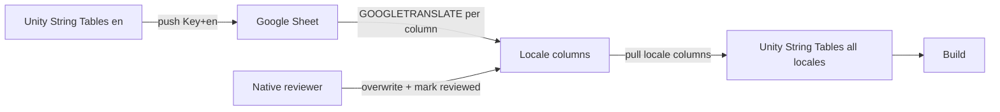

# Requirements

### Overview & Goals
Add an auto-translation workflow to the localization plan in `Docs/Mejnun-Plan.md`. All game text (UI strings **and** dealer questions) goes from Unity String Tables to a Google Sheet. Google's translation fills in every target language automatically, and Unity pulls the results back into the String Tables before a build. Adding a language should only mean adding a Locale and a sheet column.

### Scope
**In scope (plan document edits only):**
- §7 Localization: a new **Auto-translation workflow** subsection (tooling, sheet layout, push/pull rules, review gate, guardrails).
- §7: change the dealer-questions rule so dealer questions are auto-translated like other strings, then reviewed.
- §5.5 setup checklist: add a **Google Cloud** row (project, Sheets API, OAuth client).
- §9 milestones: update the M9 deliverables and exit criteria, and add a short note about early setup.
- §11 decisions log: record the decisions, and add a new open question about review depth.

**Out of scope:**
- Installing `com.unity.localization` or writing any code or assets. That stays M9 work, as the plan already schedules.
- Translating text live on the device (rejected: needs network access and an API key in the client, and costs per use).
- Translating player-entered text (nicknames).

### User Stories
- As the developer, I want to push all English game text to a Google Sheet in one click, so I don't copy strings by hand.
- As the developer, I want the sheet to translate every language automatically, so new strings show up in all 11 languages (or more) without manual work.
- As the developer, I want to pull translations back into Unity String Tables, so the build ships translated text with no runtime cost.
- As a native-speaker reviewer, I want to overwrite a machine translation in the sheet, so my fix survives later syncs.

### Functional Requirements (what the plan must specify)
- **Tooling**: Unity Localization's **Google Sheets extension** (part of `com.unity.localization`, no third-party plugin). Translation uses **Google Translate in Sheets** (`=GOOGLETRANSLATE(...)`), so no separate API key or billing is needed. Google Cloud Translation API v3 is the fallback if the formula quota or quality isn't enough.
- **Sheet layout**: one tab per String Table collection (`UI`, `DealerQuestions`). Columns are `Key` | `en` (source) | one column per locale.
- **Push (Unity → Sheet)**: only `Key` and `en` are pushed, so the translated columns are never overwritten.
- **Auto-fill**: each locale cell holds `=IF($B2="","",GOOGLETRANSLATE($B2,"en","<code>"))`. The `<code>` values map our locales to Google codes (`zh-Hans` → `zh-CN`, `pt-BR` → `pt`, and so on).
- **Review override**: a reviewer replaces a formula with plain text. A `Status` column (`auto` / `reviewed`) per locale group tracks this.
- **Pull (Sheet → Unity)**: pull the locale columns into the String Tables in the editor before every build. Translations ship inside the build and work offline.
- **Any language**: adding a locale means adding a Unity Locale, a sheet column with the formula, and a pull mapping. No code changes.
- **Dealer questions**: auto-translated like other strings, with native review before release. This replaces the current "written per language, not translated literally" rule.
- **Guardrails**: Smart String placeholders and plural blocks must survive translation, and the Arabic six-form plurals need checking by hand.

### Non-Functional Requirements
- No network access or API keys in the shipped game.
- Store listings keep using the same sheet (there is a tab for them), as §7 already says.

# Technical Design

### Current Implementation
- `Docs/Mejnun-Plan.md` §7 (lines 332–349) already plans `com.unity.localization`, String Tables, and Smart Strings for 11 locales. Line 349 says "Google Sheets extension (or CSV) round-trips the string tables, with machine translation first and native-speaker review", but it doesn't say how the machine translation works. Line 348 says dealer questions are written per language, not translated.
- §5.5 (lines 315–323) is the one-time account checklist table. §9 M9 row (line 369) owns localization delivery. §11.1/§11.2 (lines 395–427) are the decisions log and open questions.
- `Packages/manifest.json` doesn't include `com.unity.localization` yet. `.junie/plans/m2-hotseat-prototype.md` notes dealer questions are English-only until M9.

### Key Decisions
- **Translate in the editor, before the build** (not on the device): translations ship in the String Tables, with no runtime cost, no client API key, and offline play.
- **Google Sheets as the hub**, using the Google Sheets extension that comes with Unity Localization: there's no extra plugin, and the plan already names this extension.
- **`GOOGLETRANSLATE` formula in the sheet** instead of calling the Cloud Translation API from a custom editor script: it needs no billing, keys, or code, and adding a language is just a new column. Cloud Translation API v3 (glossaries, higher quality) stays documented as the upgrade path.
- **Push only the source column**: this stops the extension from overwriting formula or reviewed cells with empty Unity values.
- **Dealer questions are included fully** (your choice): this replaces the "culturally adapted, not translated" rule.

### Architecture Diagram

Unity pushes the English text, the sheet translates it, reviewers fix cells in place, and Unity pulls every locale back before building.

### Proposed Changes (all in `Docs/Mejnun-Plan.md`)
- **§7 line 348**: rewrite the dealer-questions bullet. They are now authored in English, auto-translated like UI strings, then reviewed by native speakers. Keep the "≥ 20 per language" rule.
- **§7 line 349**: replace it with a `### 7.1 Auto-translation workflow` subsection covering:
  - Tools: Google Sheets extension plus `GOOGLETRANSLATE`, with Cloud Translation API v3 as the fallback.
  - Sheet layout: tabs `UI`, `DealerQuestions`, `StoreListings`, with columns `Key | en | <locale>... | Status`.
  - The formula, plus a table mapping locale codes to Google codes (`en, ar, fa, hy, es, de, it, fr, ja, zh-CN←zh-Hans, pt←pt-BR`).
  - Push and pull rules: push maps only `Key` + `en`, pull maps only the locale columns, and you pull before every build.
  - Review rule: replace the formula with plain text and set `Status=reviewed`.
  - Adding a language: create the Locale, add the column, add the pull mapping.
  - Guardrails:
    - Keep Smart String placeholders (`{0}`, `{count:plural:...}`) intact. Either keep them out of translated text, or check them after the pull.
    - Write Arabic plural forms by hand.
    - Write RTL strings as plain text.
- **§5.5 table**: add a **Google** Cloud row. Steps: Google Cloud project → enable the Google Sheets API → OAuth desktop client (the extension needs OAuth to push) → share the sheet. Cost: free.
- **§9 M9 row**: add "Install `com.unity.localization`, Sheets push/pull, auto-translated tables for all locales" to the deliverables. Add "every String Table entry is non-empty in all locales, and placeholders are checked" to the exit criteria.
- **§9 note after line 372**: the Sheets hookup can start early (alongside the `ar` RTL test locale), so strings are synced from then on.
- **§11.1**: add rows 20 (translation in the editor via Google Sheets + `GOOGLETRANSLATE`) and 21 (dealer questions are auto-translated). **§11.2**: add **Q-J Review depth**. Do all 11 languages get a native review before release, or only `ar`/`fa`, with the rest shipping as machine translation?

### Risks
- **A push overwrites translations**: the extension writes every mapped column, so the push mapping must exclude locale columns. The plan states this explicitly.
- **Placeholder corruption**: Google may translate or reorder `{...}` tokens. Mitigation: a check after the pull (planned as part of M9's exit criteria).
- **`GOOGLETRANSLATE` limits**: these are unofficial throttling limits, but the game has little text, so the risk is low. The Cloud API is the fallback.
- **Dealer-question quality**: literal translations may read awkwardly, so the native review gate stays.

# Delivery Steps

### ✓ Step 1: Rewrite §7 Localization with the auto-translation workflow
`Docs/Mejnun-Plan.md` §7 describes the full Unity → Google Sheet → auto-translate → Unity round trip, and dealer questions are now auto-translated.

- Rewrite the dealer-questions bullet (line 348). Questions are authored in English, auto-translated, and natively reviewed. Keep the ≥ 20 per language rule.
- Replace the workflow bullet (line 349) with a new `### 7.1 Auto-translation workflow` subsection.
- Document the tools:
  - Unity Localization Google Sheets extension.
  - `GOOGLETRANSLATE` cell formula.
  - Cloud Translation API v3 as the fallback.
- Document the sheet layout (tabs `UI`, `DealerQuestions`, `StoreListings`; columns `Key | en | locales | Status`), the formula, and the locale-to-Google-code table.
- Document the push/pull rules:
  - Push only `Key` + `en`.
  - Pull only the locale columns.
  - Pull before every build.
- Document the review override, the steps for adding a language, and the guardrails (Smart String placeholders, Arabic plurals).

### ✓ Step 2: Update setup checklist, milestones and decisions log
The rest of `Docs/Mejnun-Plan.md` is consistent with the new workflow.

- §5.5: add a Google Cloud row with these steps:
  - Cloud project.
  - Enable the Sheets API.
  - OAuth desktop client.
  - Share the sheet.
  - Cost: free.
- §9 M9 row: add the `com.unity.localization` install, Sheets push/pull, and auto-translated tables to the deliverables. Add the non-empty and placeholder checks to the exit criteria.
- §9 notes: add the early Sheets hookup alongside the `ar` RTL test locale.
- §11.1: add decisions 20 (translation in the editor via Sheets + `GOOGLETRANSLATE`) and 21 (dealer questions auto-translated).
- §11.2: add open question Q-J about review depth.
- Re-read §7, §9, §11 so the wording and section references agree.