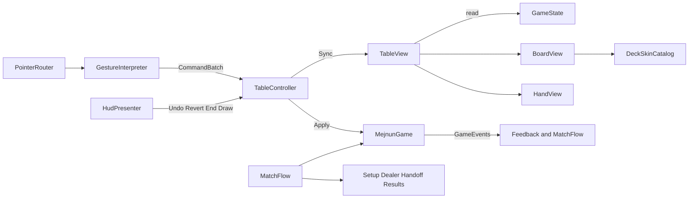

# Requirements

### Overview & Goals
Deliver **M2 – Playable hot-seat prototype** from `Docs/Mejnun-Plan.md` §9. 2–6 people can finish a pass-and-play game, on Mac and on an Android/iOS device, using the finished `Mejnun.Core` engine.

### Scope
**In scope**
- New assemblies: `Mejnun.Cosmetics`, `Mejnun.Game`, `Mejnun.UI`, `Mejnun.Editor`, and the PlayMode test assembly `Mejnun.Game.Tests`.
- `DeckSkin` ScriptableObject, plus the **Mejnun ▸ Deck Skin Importer** window with a "zig-zag" and a "row-major" layout preset.
- `Classic` and `ClassicIvory` skin assets.
- Rendering the two faces per game from `GameState.DeckFaces`, with a fallback to the base face for each deck index.
- `Table` scene, card prefab, hand view and auto-layout board view.
- Orthographic camera with zoom, pan, fit-board and auto-fit.
- The full §3.4 gesture set (drag, long-press drag, tap-select/tap-target, double-tap) for touch and mouse, with haptics.
- Minimal UI Toolkit HUD:
  - End turn, Draw/Pass, Undo, Revert, Go down.
  - Sort by suit / by rank, Fit board.
  - Opponent card counts and the draw-pile count.
  - Keyboard shortcuts.
- Game flow screens:
  - Setup (seat count and names).
  - Dealer question (tap a seat or Random).
  - Handoff ("Pass to Sam — tap to reveal").
  - Results (winner, Stalemate, Rematch).
- Rematch rule: the winner deals the next game. After a Stalemate, the dealer question is asked again.
- One small Core addition: a public `MejnunGame.CanGoDown()`.

**Out of scope** (later milestones)
- Bots and hints (M3).
- Styled UI, portrait/landscape polish, turn timers, results animations and the MEJNUN moment (M4).
- Wwise audio (M5). The invalid-drop sound gets a no-op hook only.
- Cosmetics inventory and unlocks (M6).
- Online play (M7).
- Localization: dealer questions are an English-only list for now (M9).
- The gesture tutorial (M4).

### User Stories
- As a host, I want to pick 2–6 seats and names so that we can start a local game.
- As a table, we want an embarrassing question and a tap on the chosen seat so that the dealer is picked the fun way.
- As the active player, I want to drag, long-press and tap cards so that I can build, split and rearrange sets without any modal tools.
- As the active player, I want Undo to step back one *gesture* (even when it took two engine moves) and Revert to reset everything.
- As the next player, I want a handoff screen so that the previous player can't see my hand.
- As players, we want a results screen and a Rematch where the winner deals.

### Functional Requirements
- **Faces**:
  - Cards with `Deck == 0` render with `DeckFaces[0]`, and cards with `Deck == 1` render with `DeckFaces[1]`.
  - The face pool is `{classic, classic_ivory}`.
  - A missing skin id falls back to Classic for deck 0 and Classic Ivory for deck 1.
- **Board**:
  - Sets flow into rows that wrap to the viewport aspect.
  - Each set has a green (valid) or red (invalid) outline.
  - Empty space is the drop zone for a new group.
  - Straights appear in the canonical order kept by the engine.
- **Hand**:
  - Only the active seat's hand is face-up, as a scrollable row at the bottom.
  - Hand order is a view-only preference (drag-reorder and the sort buttons) and never creates an engine move.
- **Gestures**: these follow the §3.4 table; the exact command mapping is in the Technical Design tab.
  - A mid-straight pull splits the straight into two pieces.
  - A long-press on a straight picks up the tail. On a same-kind set or the first card, it picks up the whole set.
  - Double-tap on a hand card quick-places it on the first set it validly extends. On a card placed this turn, it returns the card to the hand. On empty board, it fits the board.
- **Illegal drops** (a `RuleError` from any command in the gesture):
  - Every partial command of the gesture is rolled back.
  - The cards spring back, with a haptic buzz and an `IFeedbackSink.Invalid` hook (where audio goes later).
- **HUD buttons**:
  - End turn is enabled only when `CanEndTurn()`.
  - Go down is shown only when `CanGoDown()`.
  - Draw becomes Pass when the draw pile is empty.
  - Undo is disabled when there's no gesture to undo.
- **Keyboard**: Ctrl/Cmd+Z undo, R revert, Space end turn, D draw.
- **Flow**:
  - Handoff appears before every turn when the seat changes.
  - The game ends automatically on a `Won` or `Stalemate` event.

### Non-Functional Requirements
- `Mejnun.Core` stays `noEngineReferences`, and all 123 existing tests stay green.
- Pixel-crisp cards: point filter and pixel-snapped positions at the current zoom.
- Runs at 60 fps with 104 cards on a mid-range phone. Card views are pooled, so no per-frame allocations.
- The same code path handles touch (EnhancedTouch) and mouse.

# Technical Design

### Current Implementation
- Only `Assets/_Project/Scripts/Core` (`Mejnun.Core`) and `Tests/EditMode/Core` exist. The only scene is `Scenes/SampleScene.unity`.
- `MejnunGame.Apply(in GameCommand)` is the single entry point:
  - `ChooseDealer` / `ChooseRandomDealer` start the deal when `GameSetup.Dealer` is null.
  - `GameResult` provides the winner and next dealer (null after a Stalemate).
- `GameCommand` factories: `MoveCards(seat, ids, CardTarget)`, `SplitMeld`, `MergeMelds`, `GoDown`, `Undo`, `Revert`, `EndTurn`, `DrawOrPass`.
- `CardTarget` factories: `Hand(i)`, `Meld(id, i)`, `NewMeld(0)`.
- `TurnSession` exposes `StartSnapshot` (the hand at the start of the turn) and `Moves`. `CanGoDown()` is **internal**.
- `MeldValidator.Classify` is public. `GameEvents` raises plain C# events.
- `TurnSession.MoveCards` removing a middle card from a straight does **not** auto-split (one invalid set remains).
- Art: `Art/Cards/Decks/Classic/cards.png` (`cards_0..53`) and `ClassicIvory/cards_ivory.png`, both 64×97, point filter, PPU 100.
  - Sprite 26 is the back and sprite 53 the blank. Rows zig-zag clubs/hearts (row 1) and spades/diamonds (row 2).
- Input System 1.19 and UI Toolkit (`com.unity.modules.uielements`) are already installed.

### Key Decisions
1. **Reconcile from state** (user choice):
   - After every successful command batch, `TableView.Sync(GameState, TurnSession)` diffs the state against pooled `CardView`s keyed by card id and tweens each card to its slot.
   - `GameEvents` drive feedback only (outlines, haptics, the handoff trigger).
   - Undo and Revert therefore need no special code.
2. **Gesture = one undo step** (user choice):
   - `TableController` runs a gesture as a `CommandBatch` and pushes its applied-command count onto a per-turn stack.
   - The Undo button sends that many `Undo` commands. If a later command fails, the earlier ones are rolled back the same way.
   - Core stays unchanged, apart from adding `CanGoDown()`.
3. **Minimal UI Toolkit HUD and screens** (user choice): plain UXML/USS that M4 restyles.
4. **Hand order is view-only**: a per-seat `HandOrder` list in `Mejnun.Game`. Reordering and sorting never touch `GameState` or the undo stack.
5. **`DeckSkin` lives in a new `Mejnun.Cosmetics`** assembly (→ Core), as §3.1 says. `Mejnun.Game` references it, which is a small deviation from the §3.1 arrow list.
6. **Gesture logic is engine-agnostic C#** (`GestureInterpreter`, `BoardLayout`) inside `Mejnun.Game`. It's fed by thin MonoBehaviours, so it can be tested without scenes.
7. **Scene and prefab are generated** by the editor menu **Mejnun ▸ Setup ▸ Build Table Scene**. This avoids hand-written YAML and can be run in batch mode.

### Proposed Changes
**Gesture → command mapping** (in `GestureInterpreter`, always for `seat = State.CurrentSeat`):

| Gesture | Commands |
|---|---|
| Drag hand card(s) to a set / gap | `MoveCards(ids, Meld(id, gapIndex))` |
| Drag to empty board | `MoveCards(ids, NewMeld(0))` |
| Drag a board card from the middle of a valid straight (0 < i < n−1) | `SplitMeld(meld, i)`, then `MoveCards([card], target)` (2 commands, 1 undo) |
| Drag any other board card | `MoveCards([card], target)` |
| Long-press a straight at i > 0 | `MoveCards(tail ids, target)` (a tail dropped on empty board makes the split) |
| Long-press a same-kind set, or a straight at i = 0 | `MoveCards(all ids, target)` |
| Long-press a hand card | Picks up that card plus the selected hand cards |
| Tap a card | Toggle selection; a tap on a target sends `MoveCards(selected, target)` |
| Double-tap a hand card | First accessible meld/position where `Classify` of the result is valid → `MoveCards` |
| Double-tap a board card that is in `StartSnapshot.Hand` | `MoveCards([card], Hand(count))` |
| Drop board card(s) on the hand | Allowed only for cards that came from the hand this turn; otherwise it springs back with no command |
| Double-tap empty board | Fit board |

- **Accessible melds** for previews and quick-place: when the player is NotDown, only melds that are not in `StartSnapshot.Board`. The engine is still the authority.
- **Layout**: `BoardLayout.Compute(melds, viewportAspect, cardSize)` returns slot rects as a row-wrap. The target row width is ≈ `aspect × height`, based on the total card count.
  - Gap hit-testing between cards gives the insert index.
  - One extra "new group" slot always sits at the end.
- **Camera**: `TableCamera` handles pinch and two-finger pan, wheel zoom, and right/middle-drag pan.
  - After each Sync it auto-fits, unless the user zoomed manually since the last fit.
  - It pixel-snaps to `1 / (PPU × zoom)`.
- **Faces**: `DeckSkinCatalog.Resolve(faceId, deckIndex)` falls back to the base skin for that deck. `CardView` takes the sprite from `skin.GetFace(card.Suit, card.Rank)`.
- **Haptics**: `Haptics` (mobile `Handheld.Vibrate`, or a no-op on desktop) fires on pickup, long-press, drop and invalid.
- **Flow**: `MatchFlow` owns a `MejnunGame` per round. It runs Setup → (DealerQuestion if `Dealer` is null) → Handoff → Turn → … → Results → Rematch (`new GameSetup(seats, newSeed, dealer: result.NextDealer)`).
  - The seed comes from `DateTime.UtcNow.Ticks` (fine outside Core) and is logged for bug reports.
- **Core**: `public bool MejnunGame.CanGoDown() => Turn != null && Turn.CanGoDown();`, plus an EditMode test.

### File Structure
```
Assets/_Project/Scripts/
  Core/MejnunGame.cs                     (modified: CanGoDown)
  Cosmetics/Mejnun.Cosmetics.asmdef      (→ Core, engine refs)
  Cosmetics/DeckSkin.cs                  (SO: id, displayName, Sprite[52], cardBack, blank, pixelArt, pixelsPerUnit)
  Cosmetics/DeckSkinCatalog.cs           (SO: skins + Resolve fallback)
  Cosmetics/DeckLayoutPreset.cs          (ZigZag/RowMajor → slot index per (suit, rank))
  Game/Mejnun.Game.asmdef                (→ Core, Cosmetics, Unity.InputSystem)
  Game/Table/TableController.cs          (applies CommandBatch, undo-group stack, Sync)
  Game/Table/CommandBatch.cs
  Game/Table/TableView.cs, HandView.cs, BoardView.cs, CardView.cs, MeldOutline.cs
  Game/Table/HandOrder.cs, BoardLayout.cs
  Game/Input/PointerRouter.cs            (EnhancedTouch + mouse → Tap/DoubleTap/Drag/LongPress/Pinch)
  Game/Input/GestureInterpreter.cs       (gesture + hit → CommandBatch)
  Game/Camera/TableCamera.cs
  Game/Feedback/Haptics.cs, IFeedbackSink.cs
  Game/Flow/MatchFlow.cs, DealerQuestions.cs (SO, English list)
  UI/Mejnun.UI.asmdef                    (→ Game, Core)
  UI/HudPresenter.cs, SetupScreen.cs, DealerQuestionScreen.cs, HandoffScreen.cs, ResultsScreen.cs
  UI/Uxml/*.uxml, UI/Uss/table.uss
  Editor/Mejnun.Editor.asmdef            (Editor only → Cosmetics, Game)
  Editor/DeckSkinImporterWindow.cs       (4×13 grid, presets, Save)
  Editor/TableSceneBuilder.cs            (menu + batch method: card prefab, Table.unity, PanelSettings)
Assets/_Project/Data/Skins/Classic.asset, ClassicIvory.asset, DeckSkinCatalog.asset
Assets/_Project/Data/DealerQuestions.asset
Assets/_Project/Prefabs/Card.prefab
Assets/_Project/Scenes/Table.unity        (added to Build Settings)
Assets/_Project/Tests/PlayMode/Game/Mejnun.Game.Tests.asmdef (+ tests)
Assets/_Project/Tests/EditMode/Core/DownTests.cs (modified: CanGoDown)
```

### Architecture Diagram


### Risks
- **Zig-zag mapping (Q-A)**: where the ace sits in each row is unconfirmed. The preset assumes 2..K, then A, per pair. The importer grid is the visual check, and a test asserts all 52 slots are distinct and non-null.
- **Rollback emits `Undone` events**: `TableController` suppresses feedback while it rolls back.
- **Gesture ambiguity** (a tap vs the start of a drag vs a long-press, and a pinch starting on a card): thresholds live in one `GestureSettings` (drag 10 px, long-press 350 ms, double-tap 300 ms). A second touch cancels any card drag.
- **Device builds** need the user's signing setup. The agent can only verify that the build compiles in batch mode.

# Testing

### Validation Approach
- Run Unity in batch mode (`-runTests -testPlatform EditMode|PlayMode`) on the project. The editor must be closed, or the project lock must be honoured.
- Keep logic classes engine-light so most behaviour is covered by fast `[Test]`s inside `Mejnun.Game.Tests`. `[UnityTest]` is used for scene smoke tests.
- Build the scene and assets with `-executeMethod Mejnun.Editor.TableSceneBuilder.BuildAll`.
- A compile-only player build for macOS checks for compile errors. Real device play-through is a manual checklist for the user.

### Key Scenarios
- **Skins**:
  - The zig-zag preset maps all 52 (suit, rank) pairs to distinct sprites. Back = `cards_26`, blank = `cards_53`.
  - `Resolve("unknown", 1)` returns Classic Ivory.
- **Faces**: after a deal, every `CardView` whose `Deck` is d uses the skin `DeckFaces[d]`, and the two skins differ.
- **GestureInterpreter**:
  - A mid-straight pull produces `[SplitMeld, MoveCards]`.
  - A long-press tail produces one `MoveCards` with the tail ids.
  - Double-tap quick-place picks a valid extension, and returns nothing when none exists.
  - Double-tap on a board-origin card produces no command.
- **Undo grouping**: a 2-command gesture followed by one Undo restores the board to exactly the pre-gesture state. A failing second command leaves the state unchanged and the undo stack untouched.
- **BoardLayout**: no overlapping slots, all slots stay inside the row width, and the new-group slot comes last. Re-running for a different aspect changes the row count.
- **Core**: `CanGoDown()` is true only with a valid hand-only new meld while NotDown. All existing Core tests pass.
- **PlayMode smoke**: load `Table.unity`, start 3 seats, choose a dealer, then drive scripted commands through `TableController`. Expect a valid Sync (view count = hand count + board count), handoff shown after End turn and Draw, and the results screen on a seeded Stalemate run (all players pass with an empty pile).

### Edge Cases
- A NotDown player dragging a start-of-turn board card is rejected, and the cards spring back.
- Dropping a board-origin card on the hand is rejected.
- Draw shows "Pass" when the pile is empty.
- A 6-seat game deals 66 cards and the pile shows 38.
- Rematch after a win: the winner is the dealer. After a Stalemate, the dealer question is shown again.
- Revert after several gestures clears the undo-group stack.

### Test Changes
- Add `Tests/PlayMode/Game/Mejnun.Game.Tests.asmdef` with these test files:
  - `DeckSkinTests`
  - `GestureInterpreterTests`
  - `UndoGroupTests`
  - `BoardLayoutTests`
  - `TableSmokeTests`
- Add a `CanGoDown` test to `Tests/EditMode/Core/DownTests.cs`.

# Delivery Steps

### ✓ Step 1: Assemblies, DeckSkin and the Deck Skin Importer
The Classic and Classic Ivory skins exist as assets, generated through the importer, and resolve per deck index with fallback.

- Create the asmdefs:
  - `Mejnun.Cosmetics` (→ Core)
  - `Mejnun.Game` (→ Core, Cosmetics, Unity.InputSystem)
  - `Mejnun.UI` (→ Game, Core)
  - `Mejnun.Editor` (Editor only)
  - PlayMode `Mejnun.Game.Tests`
- Add `DeckSkin`, `DeckSkinCatalog.Resolve(faceId, deckIndex)` and `DeckLayoutPreset` (ZigZag, RowMajor; back = slot 26, blank = slot 53).
- Add `DeckSkinImporterWindow` (**Mejnun ▸ Deck Skin Importer**): pick a texture, show the 4×13 grid, click to assign slots, apply a preset, save the SO. It also exposes a static batch method.
- Generate `Data/Skins/Classic.asset`, `ClassicIvory.asset` and `DeckSkinCatalog.asset`, with ids `classic` and `classic_ivory`.
- Add the public `MejnunGame.CanGoDown()` with a test in `DownTests.cs`.
- Add `DeckSkinTests` (52 distinct slots, fallback), then run the EditMode and PlayMode tests.

### ✓ Step 2: Table scene, card views, auto-layout board and camera
Opening `Table.unity` shows a dealt game: the active seat's hand, a wrap-laid board with valid/invalid outlines, and a camera that can zoom, pan and fit.

- Add `CardView` (SpriteRenderer, face/back, selection tint, tween), `HandView`, `HandOrder`, `BoardView`, `MeldOutline` and `TableView.Sync(GameState, TurnSession)`, which reconciles pooled views by card id.
- Faces come from `DeckSkinCatalog` using `GameState.DeckFaces`.
- Add the pure `BoardLayout.Compute` (row wrap by aspect, gap hit-test, new-group slot) and re-layout on aspect change.
- Add `TableCamera`: orthographic, pinch, wheel zoom, right/middle-drag pan, fit board, auto-fit unless manually zoomed, pixel snap.
- Add `TableSceneBuilder` (**Mejnun ▸ Setup ▸ Build Table Scene**): generates `Card.prefab` and `Table.unity`, and adds the scene to Build Settings.
- Add `BoardLayoutTests` and a face-rendering check in the PlayMode tests.

### ✓ Step 3: Gesture input and command batches with grouped undo
Every §3.4 gesture on touch and mouse produces the right engine commands, illegal drops spring back, and Undo reverts one whole gesture.

- Add `PointerRouter`: EnhancedTouch plus mouse → Tap, DoubleTap, Drag, LongPress (350 ms), Pinch. Thresholds live in `GestureSettings`.
- Add `GestureInterpreter`, which turns a gesture plus hit info into a `CommandBatch`:
  - Mid-straight pull = `SplitMeld` + `MoveCards`.
  - Long-press picks up a straight tail or the whole set.
  - Tap-select / tap-target.
  - Double-tap quick-place, return-to-hand and fit.
- Add `TableController`: applies the batch, rolls back on failure, keeps the per-turn undo-group stack, and calls Sync.
- Add `Haptics` and `IFeedbackSink` (no-op for the invalid sound until M5), with drag previews that highlight the target set or gap.
- Add `GestureInterpreterTests` and `UndoGroupTests`.

### ✓ Step 4: UI Toolkit HUD with turn actions
The HUD lets the active player End turn, Draw/Pass, Undo, Revert, Go down, sort and fit, and it shows opponents and pile counts.

- Add `UI/Uxml/Hud.uxml` and `Uss/table.uss`, plus a `PanelSettings` and `UIDocument` generated in the scene builder.
- Add `HudPresenter`, bound to `TableController`:
  - Button enable rules use `CanEndTurn()`, `CanGoDown()`, the pile count (Draw → Pass) and the undo stack.
  - Sort by suit / by rank is view-only `HandOrder`.
  - Fit board.
  - An opponents strip with card counts and an active-seat marker.
- Add the keyboard shortcuts Ctrl/Cmd+Z, R, Space and D.
- Refresh on every Sync and on `GameEvents`.

### ✓ Step 5: Pass-and-play flow: setup, dealer question, handoff, results
A complete 2–6 seat hot-seat game can be played from setup to results and rematch.

- Add `MatchFlow`, which owns the `MejnunGame` per round. The seed comes from the clock and is logged.
- Add `SetupScreen` (seat count 2–6 and names) and `DealerQuestionScreen`, which uses a random question from `DealerQuestions.asset` (English list) and then a tap on a seat or Random.
- Add `HandoffScreen` ("Pass to X — tap to reveal"). It hides the hand until the tap and shows on every seat change.
- Add `ResultsScreen` for EmptyHand, FewestCards and Stalemate. Rematch uses `GameResult.NextDealer`, or re-asks the dealer question after a Stalemate.
- Add the `TableSmokeTests` PlayMode run: a seeded 3-seat game with scripted turns through to a Stalemate.
- Run the full test suite and a compile-only macOS player build.