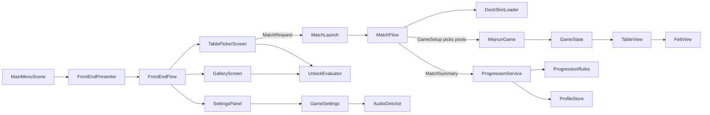

# Requirements

### Overview & Goals
M6 adds **Cosmetics & progression** (plan §3.6, §3.8, §6, §8, §9 M6).

Exit criterion: from a cold boot, a player can browse the Gallery, change settings, pick two decks and a felt, and play a game that uses them. A locked item shows its requirement and progress.

### Scope
#### In Scope
- A new **MainMenu scene** as the boot screen.
  - Main menu buttons: Play (Solo vs AI / Pass & play), Resume (only when a save exists), Online (disabled until M7), Gallery, Settings, and Quit (desktop only).
  - The existing **Setup** screen, then a new **Table picker** step (two deck slots and one felt slot), then the Table scene.
- A **shared SettingsPanel** used by both the main menu and the in-game pause menu.
  - Categories: Gameplay & confirmations, Table & hand, Hints, Accessibility, Audio (four volume sliders that drive the Wwise RTPCs), Language (English only for now), Online (quick-match bot fill), and Account (a mobile-only placeholder).
- **Gallery** with Decks and Board backgrounds tabs.
  - Each tab shows an owned/total count.
  - Decks show a hand-fan preview; felts show a swatch.
  - Locked items are dimmed, with a lock, the requirement text and a progress bar.
  - Items unlocked since the last visit get a **New** badge.
  - Deep links can open a specific item.
- **Two-decks-per-game picks.** Each slot is an owned face or Random, and the two resolved faces are always different. Slot 1 maps to `Deck 0` and slot 2 to `Deck 1`. The last picks are remembered.
- **Felts.** `TableFelt` + `TableFeltCatalog` with three render modes: **tiled texture**, **tile + border pattern**, and **single large image**.
  - Green (tiled) and Burgundy (tiled + border) are free.
  - Midnight (large image) is a locked example.
  - The chosen felt is stored as `TableFeltId` in `GameState` and in snapshots.
- **Progression.**
  - XP and levels, local stats, and 6 local achievements.
  - Unlock requirements of kind Free, Level, Wins, Achievement or Purchase, with a countable progress readout.
  - The 24 non-base skins are gated by a **mix of level and win unlocks**, plus 2 achievement unlocks.
- **Results screen additions:** XP gained, level-up, new achievements, "New in Gallery" items, and **Not unlocked yet** chips that open the matching Gallery item.
- **Addressables:** install the package and deliver one non-base skin (Pixel Pastel) from a local Addressables group, falling back to the base face if loading fails.
- A versioned **JSON profile** file and snapshot schema v2 (with migration from v1).

#### Out of Scope
- Card backs, avatars and shouts as cosmetics, plus card-back pickers.
- Cloud Save and IAP. A Purchase requirement is modelled but cannot be bought yet.
- Platform achievements (M8).
- Localization and RTL mirroring (M9). Strings are centralised so they can be localized later.
- Online picks (M7). The core keeps the existing combined-pool assigner for that.
- Rewarded-ad XP.

### User Stories
- As a player, I boot into a main menu and can play, resume, browse the Gallery or change settings.
- As a player, I pick two decks (or Random) and a felt (or Random) before a game, and the table uses them.
- As a player, I earn XP and wins that unlock decks and felts, and I can see what's locked and how close I am to unlocking it.
- As a player, I change settings from the main menu or the pause menu and see the same values in both places.
- As a player, after a game I see what I earned. If the game used a deck I don't own, I can jump to its Gallery entry.

### Functional Requirements
- **Boot:** `MainMenu.unity` is build index 0 and `Table.unity` is index 1. Esc or Android back returns to the previous front-end screen. On the main menu itself, Esc does nothing.
- **Resume:** shown only when `SavedGame.HasSave` is true. It loads the Table scene and resumes the saved game.
- **Table picker:**
  - Each deck slot lists Random plus every catalogue skin (skin level only; back variants aren't shown).
  - Locked tiles are greyed out with a lock, and tapping one opens its Gallery item. Back returns to the picker with the picks kept.
  - A skin already chosen in the other slot is disabled.
  - The felt slot lists Random plus every felt.
  - Start is enabled only when the explicit picks differ.
  - A remembered pick that is no longer owned resets to Random.
- **Random resolution** uses the game's seeded RNG at deal time:
  - The Random-deck pool is the player's owned faces. In Solo, each bot adds one random catalogue face (the Q-E default).
  - A Random felt preference becomes the pool of owned felts, and the game draws one felt from it.
- **Progression rules** (defaults, tunable in one place):
  - XP per game: +20 for playing, +40 for a win, +20 extra for a MEJNUN (empty-hand) win, +10 for a Stalemate.
  - XP to go from level *n* to *n*+1 is 100 + 25·(*n*−1).
  - Solo: a win counts when the human seat wins.
  - Pass & play with 2+ humans: participation XP only, with no win stats or win XP.
- **Achievements (local):** First Game, First Win, First MEJNUN, Ten Wins, Beat a Hard Bot (solo win against at least one Hard bot), Full Table (finish a 6-seat game).
- **Ownership** is derived: an item is owned if its requirement is met or it has been granted. New = owned items not yet in the Gallery seen set, which is seeded with the free items.
- **Settings** save as soon as they change. Volume sliders (0–1) map to `Volume_Master/Music/SFX/Voice` (0–100).
- **Felt rendering:**
  - The tiled texture scrolls with board pan and zoom.
  - The border frame and the large image stay fixed to the screen, cover the viewport in any aspect ratio, and sit behind every card.

### Non-Functional Requirements
- Front-end screens support portrait and landscape, respond to aspect changes, and respect the device safe area.
- Old v1 snapshots and saved games still load.
- A missing or corrupt profile file falls back to a fresh profile; a corrupt file is first backed up as `.bak`.
- If an Addressable skin fails to load, the client falls back to the base face for that deck index and the game continues.

# Technical Design

### Current Implementation
- **Core:**
  - `GameSetup` carries only a `FacePool`.
  - `MejnunGame` (line ~173) calls `DeckFaceAssigner.Assign(setup.FacePool, rng)` after the shuffle. That's the old random-from-pool model.
  - `GameState` has `DeckFaces` but no felt.
  - `SnapshotSerializer.Version = 1`, and `Read` rejects any other version.
- **Cosmetics:** `DeckSkin` and `DeckSkinCatalog` (26 skins in `Data/Skins`, with a per-index fallback to Classic/Ivory). There is no unlock data, felt, inventory or progression.
- **Game:**
  - `MatchFlow` (`MatchFlowScreen.Setup/DealerQuestion/Handoff/Turn/Results`) builds the face pool from the whole catalog.
  - `SavedGame` writes a v1 envelope around the snapshot.
  - `GameSettings` is a static wrapper over PlayerPrefs.
  - `AudioDirector` auto-attaches only in scenes that contain a `MatchFlow`.
  - The felt is just `camera.backgroundColor`.
- **UI:**
  - `MatchFlowPresenter` toggles plain C# screen controllers inside `FlowScreens.uxml`.
  - The settings UI is inline in `Hud.uxml` and bound in `HudPresenter` (~lines 276–379).
  - `Mejnun.UI` doesn't reference `Mejnun.Cosmetics`.
- **Scenes:** `Table.unity` is generated by `TableSceneBuilder`. PlayMode tests load "Table" directly and drive `MatchFlow`.

### Key Decisions
- **Separate MainMenu scene** (your choice). A static `MatchLaunch` handoff carries a `MatchRequest` into `Table.unity`.
  - If the Table scene loads with no pending request, `MatchFlow` stays `Idle`. Existing PlayMode tests and direct editor play keep working.
- **Pure progression model plus a thin service** (your choice).
  - Rules, unlock evaluation, achievements and the profile model live in `Mejnun.Cosmetics` and are EditMode-testable.
  - `ProgressionService` (in Game) loads and saves the profile and records match results.
- **Versioned JSON profile** (your choice): `persistentDataPath/mejnun_profile.json` with `schemaVersion`, written atomically (temp file + move) like `SavedGame`.
- **Ownership is derived, not stored.** Only explicit grants (future purchases) are persisted, so changing the unlock table never leaves inventory out of sync.
- **Core stays the authority for faces and felt.** Picks and pools go into `GameSetup`, and resolution uses the seeded RNG at deal time, after the shuffle, so dealt hands don't change. The legacy pool path is kept for M7's online combined-picks flow.
- **Addressables:** one skin (Pixel Pastel) is delivered through an `AssetReferenceT<DeckSkin>` catalog entry.
  - Candidate faces are preloaded before the round starts.
  - If every candidate is built in, the match starts synchronously, so existing synchronous tests keep working.
- **Felt render modes** are defined in data: `Tiled`, `TiledWithBorder` (border uses a 9-slice sprite) and `Image` (aspect-fill).
- **SettingsPanel is a UXML template plus a C# binder**, instantiated in both `Hud.uxml` and `FrontEnd.uxml`. `GameSettings` gains a `Changed` event.

### Architecture Diagram

The front end lives in its own scene. The Table picker hands a `MatchRequest` to `MatchFlow` through `MatchLaunch`. `MatchFlow` preloads any Addressable skins and builds `GameSetup` with picks and pools. Core resolves faces and felt into `GameState`, which `TableView`/`FeltView` render. When a game ends, `MatchFlow` reports a `MatchSummary` to `ProgressionService`. Gallery and picker read ownership from `UnlockEvaluator`.

### Data Models / Contracts
```csharp
// Mejnun.Core
public GameSetup(int seatCount, ulong seed, int? dealer = null, int turnSeconds = 0,
    IReadOnlyList<string> facePool = null,            // Random candidates (legacy: combined pool)
    IReadOnlyList<string> deckPicks = null,           // length 2, null entry = Random; null list = legacy path
    IReadOnlyList<string> feltPool = null);           // resolved felt preferences
public static string[] DeckFaceAssigner.AssignFromPicks(IReadOnlyList<string> picks,
    IReadOnlyList<string> randomPool, Pcg32 rng);      // distinct skins; Classic/Ivory backfill
public static class TableFeltAssigner { public const string GreenFelt = "green";
    public static string Assign(IReadOnlyList<string> feltPool, Pcg32 rng); }
GameState.TableFeltId { get; internal set; }
GameEvents.TableFeltAssigned (Action<string>)
SnapshotSerializer.Version = 2;  // v1 read: deckPicks=null, feltPool=empty, TableFeltId="green"

// Mejnun.Cosmetics
public enum UnlockKind { Free, Level, Wins, Achievement, Purchase }
[Serializable] public sealed class UnlockRequirement {
    UnlockKind kind; int target; string achievementId;
    public UnlockProgress Evaluate(PlayerProfile p);   // Unlocked, Current, Required, IsCountable
    public string Describe(UnlockProgress pr); }       // "Reach level 5", "Win 10 games"
public enum FeltRenderMode { Tiled, TiledWithBorder, Image }
public sealed class TableFelt : ScriptableObject {
    string id, displayName; FeltRenderMode mode; Sprite tile; float tileWorldSize;
    Sprite border /*9-slice*/; Sprite image; Color tint; Color clearColor; UnlockRequirement unlock; }
public sealed class TableFeltCatalog : ScriptableObject { IReadOnlyList<TableFelt> Felts; TableFelt Resolve(string id); }
// DeckSkin += UnlockRequirement Unlock
// DeckSkinCatalog += List<AddressableDeckSkinEntry> addressableSkins (id, displayName, unlock, AssetReferenceT<DeckSkin>)
//                 + IReadOnlyList<DeckSkinInfo> GetEntries(); RegisterLoaded(DeckSkin)
public sealed class CosmeticCatalog : ScriptableObject { DeckSkinCatalog Decks; TableFeltCatalog Felts; }
[Serializable] public sealed class PlayerProfile {
    int schemaVersion = 1; int xp; PlayerStats stats /*played,wins,mejnunWins,stalemates*/;
    List<string> achievements, grantedItems, seenItems; string[] lastDeckPicks /*""=Random*/; string lastFeltPick; }
public readonly struct MatchSummary { MatchMode Mode; int SeatCount; int HumanCount;
    bool LocalWin; bool MejnunWin; bool Stalemate; bool BeatHardBot; }
public static class ProgressionRules { int XpFor(MatchSummary); int LevelForXp(int xp); (int into,int needed) LevelProgress(int xp); }
public static class AchievementIds { FirstGame, FirstWin, FirstMejnun, TenWins, BeatHardBot, FullTable }
public static class AchievementTracker { IReadOnlyList<string> Evaluate(PlayerProfile, MatchSummary); }
public sealed class UnlockEvaluator { bool IsOwned(string itemId, UnlockRequirement r);
    string[] OwnedFaceIds(); string[] OwnedFeltIds(); IReadOnlyList<string> NewItems(); }
public sealed class ProgressionReport { int XpGained, LevelBefore, LevelAfter; IReadOnlyList<string> NewAchievements, NewlyUnlockedItems; }
public static class ProfileSerializer { string ToJson(PlayerProfile); PlayerProfile FromJson(string); /* migrations */ }

// Mejnun.Game
public sealed class MatchRequest { SeatConfig[] Seats; int TurnSeconds; MatchMode Mode; bool Resume;
    string[] DeckPicks; string[] RandomFacePool; string[] FeltPool; }
public static class MatchLaunch { void Set(MatchRequest r); bool TryTake(out MatchRequest r); }
public static class SceneFlow { void LoadTable(MatchRequest r); void LoadMainMenu(MenuDestination d = default); MenuDestination PendingDestination; }
public sealed class ProgressionService { static ProgressionService Instance; PlayerProfile Profile;
    ProgressionReport RecordMatch(MatchSummary s); void MarkSeen(IEnumerable<string> ids);
    void SetLastPicks(string[] decks, string felt); event Action Changed; }
// GameSettings += VolumeMaster/Music/Sfx/Voice (0..1, default 1), Language ("en"),
//                QuickMatchBotFill (0/30/60, default 60), static event Action<string> Changed
// MatchFlowScreen: Setup -> Idle; MatchFlow.ReturnToSetup -> ReturnToMenu(MenuDestination)
```

### Proposed Changes
- **Core:**
  - `MejnunGame` deal: shuffle, then faces (`AssignFromPicks` when `DeckPicks != null`, otherwise legacy `Assign`), then felt.
  - Raise `DeckFacesAssigned` and `TableFeltAssigned`.
  - Two identical explicit picks are handled defensively: slot 2 becomes Random.
- **Progression flow:** `MatchFlow.ShowResults` builds a `MatchSummary` from seats and the `GameResult`, then calls `ProgressionService.RecordMatch` once per game and exposes `LastProgression` for `ResultsScreen`.
- **Launch and preload:**
  - `MatchFlow.Start` consumes `MatchLaunch`: Resume → `ResumeSavedGame`, otherwise `StartMatch(request)`.
  - The candidate faces (picks ∪ random pool, or the snapshot's `DeckFaces` on resume) are preloaded through `DeckSkinLoader` before `StartRound`.
  - Rematch reuses the stored request pools.
- **Felt:** `FeltView` (new, under the Table root) runs in `LateUpdate` against `TableCamera`:
  - Tiled: a `SpriteRenderer` (draw mode Tiled), snapped to a tile grid around the camera.
  - Border: a screen-fixed Sliced renderer.
  - Image: a screen-fixed renderer with aspect-fill.
  - Sorting order is −100. `TableView.Sync` applies `state.TableFeltId` through `TableFeltCatalog`, falling back to Green.
- **Audio:**
  - Add the `Volume_*` constants to `AudioIds`.
  - `AudioDirector` applies the volumes (×100) on enable and on `GameSettings.Changed`.
  - It also auto-attaches in scenes with a `MenuAudioCue` marker: `Game_Phase=Menu` plus `Music_Menu`.
  - `MatchFlowScreen.Idle` replaces `Setup` in the music mapping.
- **Front end:**
  - `FrontEndPresenter` (MonoBehaviour) owns a `FrontEndFlow` back stack (`MainMenu`, `Setup`, `TablePicker`, `Gallery`, `Settings`), handles Esc through the Input System, and applies safe area and portrait/landscape classes through `SafeAreaUtility`.
  - On load it honours `SceneFlow.PendingDestination`, for example opening a Gallery item from the results screen.
  - `SetupScreen` moves to the front end: the mode is preset from the Play choice, Resume moves to the main menu, and Start becomes Next.
- **HUD:**
  - `Hud.uxml` instantiates the `SettingsPanel` template; `HudPresenter` drops its inline bindings and keeps open/close plus the `RefreshHintOptions` hook.
  - Exit and the results Menu button call `MatchFlow.ReturnToMenu`. The setup screen is removed from `FlowScreens.uxml`.
- **Addressables:**
  - Add `com.unity.addressables` to `Packages/manifest.json`.
  - Add `Unity.Addressables` and `Unity.ResourceManager` references to `Mejnun.Cosmetics.asmdef`.
  - Create an `OptionalDecks` local group. Pixel Pastel moves from `skins` to `addressableSkins`.
  - `TableSceneBuilder.BuildMacOSPlayer` builds Addressables content first.
- **Content:** the `CosmeticsSetup` editor menu applies the unlock table, generates placeholder felt textures and assets, and creates `CosmeticCatalog.asset`. New imports default to Free.

| Unlock | Skins (asset names) |
|---|---|
| Free | Classic, ClassicIvory |
| Level 2–16 | PixelPastel (L2), card_pngs (L3), paper_cards1_1 (L4), sofu_small (L5), sofu_medium (L6), sofu_large (L7), light_1color_0 (L8), light_2color_0 (L9), light_2color_1 (L10), light_4color_0 (L12), light_4color_1 (L14), light_4color_2 (L16) |
| Wins 1–40 | sepia_1color_0 (1), sepia_2color_0 (3), sepia_2color_1 (5), dark_1color_0 (8), dark_2color_0 (12), contrast_2color_0 (15), contrast_2color_1 (20), contrast_4color_0 (25), contrast_4color_1 (30), contrast_4color_2 (40) |
| Achievement | reigns (First MEJNUN), hack_deck (Beat a Hard Bot) |
| Felts | Green (Free, Tiled), Burgundy (Free, TiledWithBorder), Midnight (Level 3, Image) |

### File Structure
```
Assets/_Project/
  Scenes/MainMenu.unity                                  (new, generated)
  Data/Felts/{Green,Burgundy,Midnight}.asset, TableFeltCatalog.asset   (new)
  Data/Cosmetics/CosmeticCatalog.asset                   (new)
  Art/Felts/*.png                                        (new placeholder pixel art)
  Scripts/Core/Faces/DeckFaceAssigner.cs                 (AssignFromPicks)
  Scripts/Core/Faces/TableFeltAssigner.cs                (new)
  Scripts/Core/State/{GameSetup,GameState}.cs, MejnunGame.cs, Events/GameEvents.cs, Serialization/SnapshotSerializer.cs
  Scripts/Cosmetics/{DeckSkin,DeckSkinCatalog}.cs        (unlock + addressable entries)
  Scripts/Cosmetics/Unlocks/{UnlockRequirement,UnlockProgress,UnlockEvaluator}.cs     (new)
  Scripts/Cosmetics/Felts/{TableFelt,TableFeltCatalog}.cs                              (new)
  Scripts/Cosmetics/{CosmeticCatalog,DeckSkinLoader}.cs                                (new)
  Scripts/Cosmetics/Progression/{PlayerProfile,ProfileSerializer,ProgressionRules,MatchSummary,AchievementIds,AchievementTracker,ProgressionReport}.cs (new)
  Scripts/Game/Progression/{ProfileStore,ProgressionService}.cs                         (new)
  Scripts/Game/Flow/{MatchRequest,MatchLaunch,SceneFlow}.cs                            (new)
  Scripts/Game/Flow/MatchFlow.cs, Settings/GameSettings.cs, Audio/AudioDirector.cs, Table/TableView.cs
  Scripts/Game/Table/FeltView.cs, Audio/MenuAudioCue.cs                                (new)
  Scripts/Audio/AudioIds.cs
  Scripts/UI/FrontEnd/{FrontEndPresenter,FrontEndFlow,MainMenuScreen,TablePickerScreen,GalleryScreen,SafeAreaUtility}.cs (new)
  Scripts/UI/Settings/SettingsPanel.cs                   (new; bindings moved from HudPresenter)
  Scripts/UI/SetupScreen.cs → Scripts/UI/FrontEnd/SetupScreen.cs (moved)
  Scripts/UI/{HudPresenter,MatchFlowPresenter,ResultsScreen}.cs, Mejnun.UI.asmdef (+Mejnun.Cosmetics)
  Scripts/UI/Uxml/{FrontEnd,SettingsPanel}.uxml (new), Hud.uxml, FlowScreens.uxml
  Scripts/UI/Uss/frontend.uss (new), flow.uss, table.uss
  Scripts/Editor/{FrontEndSceneBuilder,CosmeticsSetup,AddressablesSetup,ProfileDebugMenu}.cs (new), TableSceneBuilder.cs
  Tests/EditMode/Cosmetics/Mejnun.Cosmetics.Tests.asmdef + tests  (new)
Packages/manifest.json (+com.unity.addressables)
ProjectSettings/EditorBuildSettings.asset (MainMenu=0, Table=1)
Docs/Mejnun-Plan.md (M6 implementation note)
```

### Risks
- **RNG stream:** the felt draw adds RNG consumption after the deal. Snapshot byte fixtures and seeded expectations may change. Mitigation: draw after the shuffle and faces, and update only the byte-level fixtures.
- **v1 compatibility:** capture a v1 snapshot fixture (base64) *before* changing the serializer, so the migration test reads real v1 bytes.
- **Addressables in builds:** content must be built before the player build, and a missing bundle falls back per deck index. Editor play mode uses the Asset Database play-mode script.
- **Wwise in the MainMenu scene:** check that the sound engine initializes outside the Table scene. If it doesn't, the scene builder adds the initializer object.
- **PlayMode tests** that load Table rely on `MatchFlow`. The `Idle` start and synchronous starts for built-in skins keep them valid; tests that reference `MatchFlowScreen.Setup` or `ReturnToSetup` are updated.

# Testing

### Validation Approach
- Run the Unity Test Runner in batch mode (`Unity -batchmode -projectPath . -runTests -testPlatform EditMode|PlayMode`) after each stage.
- The existing EditMode (169) and PlayMode (51) suites must stay green, with updates only where APIs were renamed.
- Regenerate scenes through the editor builders: **Mejnun ▸ Setup ▸ Build Table Scene**, **Build Main Menu Scene**, **Apply Cosmetic Unlocks**.

### Key Scenarios
- **Core (EditMode):**
  - Explicit picks map slot 1 → `Deck 0` and slot 2 → `Deck 1`.
  - Random slots never duplicate the other slot's skin.
  - Two Random slots give distinct faces, deterministic for a given seed.
  - The legacy pool path is unchanged.
  - The felt is drawn only from the pool, and an empty pool gives Green.
  - A v2 snapshot round-trips `DeckPicks`, `FeltPool` and `TableFeltId` with identical bytes for the same seed and commands.
- **Cosmetics (new EditMode assembly):**
  - The XP formula and level curve, including boundaries.
  - Pass & play with 2+ humans gives no win credit.
  - Each achievement triggers exactly once.
  - `UnlockRequirement` progress for Level, Wins and Achievement, and the Free and Purchase cases.
  - `UnlockEvaluator` owned/new sets.
  - `ProfileSerializer` round-trip and migration from an older or missing schema.
- **PlayMode:**
  - Cold boot of `MainMenu` → Play → Solo → Setup → Table picker (Classic + Ivory, Burgundy) → Start → Table loads with `DeckFaces == picks` and `TableFeltId == burgundy`.
  - A setting changed in the menu `SettingsPanel` shows the same value in the pause-menu `SettingsPanel`.
  - With a fresh profile, a locked Gallery item shows its requirement text and progress bar (e.g. "Win 3 games", 0/3), and a deep link selects that item.
  - `FeltView` covers the camera viewport in all three modes after zoom, pan and aspect changes, and stays behind cards.
  - The Addressable Pixel Pastel loads and renders. A forced load failure falls back to the base face for that deck index.
  - Finishing a scripted game records XP once and shows it on the results screen.

### Edge Cases
- A remembered pick that isn't owned resets to Random.
- The Start button is disabled for duplicate explicit picks.
- A corrupt profile JSON is backed up and replaced with a fresh profile.
- Resuming a v1 saved game after the upgrade works.
- Loading Table with no `MatchRequest` leaves it Idle (no exception, no redirect).
- A resumed game that finishes is recorded only once.

### Test Changes
- Update `FaceAssignmentTests`, `SnapshotTests`, `HudPresenterTests`, `TableSmokeTests` and `TableViewTests` for the API renames (`Idle`, `ReturnToMenu`, `SettingsPanel`).
- Add `PickAssignmentTests`, `FeltAssignmentTests`, `SnapshotMigrationTests`, `Tests/EditMode/Cosmetics/*`, `FrontEndFlowTests`, `GalleryTests`, `FeltViewTests` and `AddressableSkinTests`.

# Delivery Steps

### ✓ Step 1: Core: deck picks, felt assignment and snapshot v2
Core resolves two deck picks and a felt from seeded pools, and stores `TableFeltId` in state and v2 snapshots, with v1 migration.

- Capture a v1 snapshot fixture (base64) in `Tests/EditMode/Core` before touching the serializer.
- Extend `GameSetup` with `deckPicks` and `feltPool` (the legacy `facePool` path is kept).
- Add `DeckFaceAssigner.AssignFromPicks`: slot mapping, distinct Random draws, Classic/Ivory backfill, and defensive handling of duplicate picks.
- Add `TableFeltAssigner` (Green default), `GameState.TableFeltId` and the `GameEvents.TableFeltAssigned` event.
- Wire both assigners into the `MejnunGame` deal after the shuffle.
- `SnapshotSerializer` v2: write the picks, felt pool and felt id; read v1 with defaults.
- Add `PickAssignmentTests`, `FeltAssignmentTests` and `SnapshotMigrationTests`, update `FaceAssignmentTests` and `SnapshotTests`, and run the EditMode suite.

### ✓ Step 2: Cosmetics data model, progression rules and profile service
Unlock requirements, felts, catalog, XP/levels, achievements and a persisted JSON profile exist and record finished games.

- `Mejnun.Cosmetics`:
  - `UnlockRequirement`/`UnlockProgress`, and an `Unlock` field on `DeckSkin`.
  - `TableFelt` (Tiled / TiledWithBorder / Image), `TableFeltCatalog` and `CosmeticCatalog`.
  - `PlayerProfile`, `ProfileSerializer` (schema versioning and migrations), `ProgressionRules`, `MatchSummary`, `AchievementIds`/`AchievementTracker`, `UnlockEvaluator` and `ProgressionReport`.
- `Mejnun.Game`:
  - `ProfileStore`: atomic JSON file with a `.bak` backup on corruption.
  - `ProgressionService` singleton.
  - `MatchFlow.ShowResults` builds a `MatchSummary`, records it once per game and exposes `LastProgression`.
- Editor:
  - `CosmeticsSetup` menu: applies the mixed level/wins/achievement unlock table to the 24 skins, generates placeholder felt textures, and creates Green, Burgundy, Midnight, `TableFeltCatalog` and `CosmeticCatalog`.
  - `ProfileDebugMenu`: add XP, add win, unlock all, reset.
- New `Mejnun.Cosmetics.Tests` EditMode assembly covering the rules, achievements, unlock progress, ownership/new sets and profile migration.

### ✓ Step 3: Felt rendering and Addressables skin delivery
The table renders the assigned felt in all three modes, and one skin loads through Addressables with a per-deck fallback.

- Add `FeltView` under the Table root:
  - The tiled texture follows the world (grid-snapped around the `TableCamera`).
  - The 9-slice border and the aspect-fill image are screen-fixed, at sorting order −100.
  - Camera clear colour is taken from the felt.
- `TableView.Sync` applies `state.TableFeltId` through `TableFeltCatalog`, falling back to Green. `TableSceneBuilder` wires `FeltView` and the felt catalog.
- Add `com.unity.addressables`, the asmdef references and the `AddressablesSetup` editor step (settings + `OptionalDecks` local group).
- Move Pixel Pastel to `DeckSkinCatalog.addressableSkins`.
- Add `DeckSkinLoader` and `DeckSkinCatalog.GetEntries`/`RegisterLoaded`.
- `MatchFlow` preloads candidate faces before `StartRound` and on resume; the start stays synchronous when every candidate is built in.
- `BuildMacOSPlayer` builds Addressables content first.
- Add `FeltViewTests` and `AddressableSkinTests` (successful load and forced-failure fallback).

### ✓ Step 4: Shared SettingsPanel with audio volumes
One `SettingsPanel` template and binder serves the pause menu, and volume sliders drive the Wwise RTPCs.

- `GameSettings`: add `VolumeMaster/Music/Sfx/Voice`, `Language`, `QuickMatchBotFill` and a static `Changed` event, and extend `ResetForTests`.
- New `Uxml/SettingsPanel.uxml` and `UI/Settings/SettingsPanel.cs` with these categories:
  - Gameplay & confirmations (the four confirm toggles, CPU speed, easy opening deal, fast-forward)
  - Table & hand (the existing sliders and board options)
  - Hints
  - Accessibility
  - Audio
  - Language (English)
  - Online (bot fill)
  - Account (mobile-only, disabled placeholder)
- `Hud.uxml` instantiates the template; move the ~100 lines of bindings out of `HudPresenter` and keep the `RefreshHintOptions` hook through `Changed`.
- Add the `Volume_*` constants to `AudioIds`. `AudioDirector` applies volume ×100 on enable and on change.
- Update `HudPresenterTests` and add settings-persistence assertions.

### ✓ Step 5: MainMenu scene, front-end flow and cross-scene launch
The game boots into a main menu that can launch, resume and return from the Table scene. Setup and Settings work from the menu.

- Add `MatchRequest`, `MatchLaunch` and `SceneFlow` (with `MenuDestination` deep links).
- `MatchFlow`:
  - `Setup` becomes `Idle`.
  - On `Start` it consumes a pending request (new match or resume).
  - `ReturnToSetup` becomes `ReturnToMenu`; HUD Exit and the results Menu button use it.
  - Rematch reuses the request pools.
- Front-end UI (`FrontEnd.uxml`, `frontend.uss`):
  - `FrontEndPresenter` and `FrontEndFlow` with a back stack and Esc/back handling.
  - `SafeAreaUtility` for portrait/landscape classes.
  - `MainMenuScreen`: Play → Solo / Pass & play, Resume, disabled Online, Gallery, Settings, desktop Quit, and a level/XP badge.
  - The `SettingsPanel` instance.
  - `SetupScreen` moved from `FlowScreens.uxml`, with the mode preset and Next.
- Add the `Mejnun.Cosmetics` reference to `Mejnun.UI.asmdef`.
- Add a `MenuAudioCue` marker: `AudioDirector` attaches in the menu scene and plays `Music_Menu`.
- `FrontEndSceneBuilder` generates `MainMenu.unity`. Build settings become MainMenu=0 and Table=1, with SampleScene disabled.
- Update the existing PlayMode tests for the renames, and add `FrontEndFlowTests` (cold-boot navigation, Resume visibility, back stack).

### ✓ Step 6: Table picker, Gallery and results progression UI
Players pick decks and a felt, browse the Gallery with locks, progress and New badges, and see rewards on the results screen.

- `TablePickerScreen`:
  - Two deck slots and one felt slot, each with a Random tile.
  - Locked tiles are greyed with a lock and open the Gallery item; the skin used in the other slot is disabled; Start is gated on distinct picks.
  - Picks are remembered through `ProgressionService.SetLastPicks`, resetting to Random if no longer owned.
  - Start builds the `MatchRequest`: owned-face Random pool plus one catalogue face per bot in Solo, and the felt pool. Then it loads Table.
- `GalleryScreen`:
  - Decks and Board backgrounds tabs with owned/total counts.
  - Hand-fan previews (Addressable skins load on demand) and felt swatches.
  - Locked items show dimmed previews, a lock, `UnlockRequirement.Describe` text and a `ProgressBar`.
  - New badges come from the seen set (marked on leave), and deep-link selection is supported.
- `ResultsScreen`: XP gained, level progress and level-up, new achievements, "New in Gallery", and Not-unlocked-yet chips for unowned `DeckFaces` or felt that call `ReturnToMenu(Gallery(itemId))`.
- Add `GalleryTests` (locked-item requirement and progress, deep link, New badge) and an end-to-end PlayMode test: boot → pick two decks and a felt → play a scripted game → assert faces, felt and recorded XP.
- Add an M6 implementation note to §9 of `Docs/Mejnun-Plan.md` with the test counts.