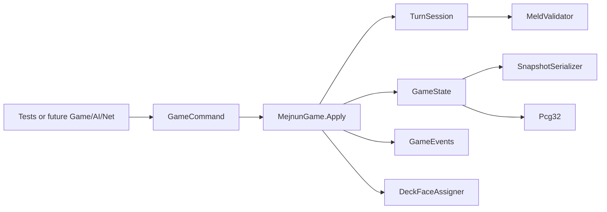

# Requirements

### Overview & Goals
Deliver **milestone M1** from `Docs/Mejnun-Plan.md`: `Mejnun.Core`, a pure C# rules engine with no `UnityEngine` references. It implements every rule in §1 exactly and is the base for every later mode: hot-seat (M2), AI (M3) and online (M7).

Exit criteria (from §9): **≥ 95% line coverage** in EditMode tests, and **every §1 rule has a named test**.

### Scope
**In scope**
- Cards, the 104-card shoe, card ids (`deckIndex*52 + suit*13 + rankIndex`), doubles.
- A deterministic seeded RNG and shuffle.
- `MeldValidator`: same-kind sets of 3–4, straights of 3–13 with ace low or high, no wrap-around, no doubles. It returns invalid reasons.
- Game setup for 2–6 seats, dealer selection state, dealing 11 each, and the first turn going to the player left of the dealer.
- `TurnSession`: Not-down / Down phases, go-down commit, moves, Undo, Revert, Draw/Pass, End turn gating, and all four timeout outcomes.
- End conditions: the instant MEJNUN win, and the empty-pile pass cycle ending in a sole-fewest win or a Stalemate.
- Picking the two-faces-per-game deck skins (opaque string ids) from a pool.
- `GameEvents` (plain C# events).
- Versioned binary snapshot serialization, plus deterministic replay (same seed + same commands = identical state).
- EditMode test assembly and the Code Coverage package.
- Update `Mejnun-Plan.md` to record the resolved **Q-B** decision.

**Out of scope**
Unity scenes, views, input and gestures (M2), AI and hints (M3), the UI, the localized dealer-question table and online voting (M4/M7), audio, cosmetics inventory and building the face pool from inventories, networking and command wire format (M7), and the wall-clock timer. Core only receives a `TimeoutTurn` command.

### Decisions confirmed with you
- Folder layout follows the doc: `Assets/_Project/Scripts/Core/`. The unused placeholder `Scripts/Runtime/TestScript.cs` is removed.
- **Q-B**: after a **Stalemate** a new dealer is chosen through the dealer-question prompt. A **sole player with the fewest cards still wins** (a normal win, not the MEJNUN moment) and deals next.
- A single `Apply(command)` entry point.
- Undo uses a start-of-turn snapshot plus move-list replay.

### Functional Requirements
1. **Setup**: 2–6 seats and a seed. If a dealer is given (the previous winner), the game deals straight away. Otherwise it starts in `ChoosingDealer` and accepts `ChooseDealer(seat)` or `ChooseRandomDealer`.
2. **Deal**: one card at a time, clockwise, starting left of the dealer, until everyone has 11. The rest form the draw pile (82…38 cards). Two distinct deck faces are chosen at deal time.
3. **Not down**: the player can only create new sets or add to sets they created this turn, using only cards from their hand. They can't touch melds that started on the board. `GoDown` commits when there is at least one set and every new set is valid and made only of hand cards. After that, full board access is allowed in the same turn. Ending the turn (or a timeout case 3) with valid hand-only sets is treated as an implicit go-down. Undoing or reverting past the go-down returns the player to Not down.
4. **Down**: the player may move any card or group of cards, split straights, merge, take from 4-card same-kind sets, and form temporary invalid groups.
5. **Hand rule**: only cards that came from your hand this turn may return to your hand.
6. **End turn**: allowed only when the board is valid and at least one hand card is on the board.
7. **Draw / Pass**: always allowed. It reverts the board, draws one card (or nothing when the pile is empty, which makes it a Pass) and ends the turn.
8. **Undo** goes back one move at a time. **Revert** restores the start-of-turn board and always succeeds.
9. **Timeout** resolves exactly as §1.9 cases 1–4.
10. **Win**: when a player's hand is empty and the board is valid, the game ends immediately with an `EmptyHand` win (the MEJNUN moment).
11. **Empty pile**: when every seat passes in a row with no card placed, the game ends. One player with the fewest cards gives a `FewestCards` win. A tie gives a `Stalemate` with no winner, and the next dealer has to be chosen by prompt.
12. **Errors**: an illegal command changes nothing and returns a reason code. It never throws for player mistakes.

### Non-Functional Requirements
- `Mejnun.Core.asmdef` has `noEngineReferences: true`.
- Fully deterministic: no `System.Random` or time APIs.
- Allocation-light. Validating a full board is cheap enough for the M3 AI solver to call it repeatedly.

# Technical Design

### Current Implementation
- Unity 6000.4.0f1 project. The `Assets/_Project/` folders exist (Scripts/Runtime and Editor, Tests/EditMode and PlayMode with `.gitkeep`), but there are no asmdefs.
- `Scripts/Runtime/TestScript.cs` is an empty MonoBehaviour that no scene or asset references.
- `com.unity.test-framework` 1.6.0 is installed. Code Coverage isn't.

### Key Decisions
- **Single command entry point**: `MejnunGame.Apply(in GameCommand)` → `CommandResult`. All inputs (touch, AI, network) produce the same command structs, so there's one validation path and the command list doubles as the replay log.
- **Undo = snapshot + replay**: `TurnSession` keeps an immutable start-of-turn `BoardSnapshot` (melds plus the hand) and a `List<Move>`. Undo removes the last move and rebuilds by replaying from the snapshot. Revert clears the list. Draw, Pass and timeout reuse Revert. Turns are short, so replay costs very little and there are no inverse operations to get wrong.
- **Canonical straight ordering**: after each move, any meld that classifies as a straight is reordered into canonical rank order (ace placed low or high to match). Same-kind and invalid groups keep insertion order. That way `SplitMeld(meldId, index)` behaves predictably for the views.
- **Seeded PCG32 RNG** with serialisable state, plus a Fisher–Yates shuffle.
- **Binary snapshots**: a hand-written `BinaryWriter`/`Reader` with a version header, using card ids as bytes. It's compact for M7 and needs neither Unity's `JsonUtility` nor extra packages.
- **Faces**: Core gets the face pool as a list of strings and picks 2 distinct ids. If there are fewer than 2, it tops up with the base ids `classic` and `classic_ivory`.

### Data Models / Contracts
```csharp
namespace Mejnun.Core {
  enum Suit : byte { Clubs, Diamonds, Hearts, Spades }
  enum Rank : byte { Ace, Two, …, King }           // rankIndex 0..12
  readonly struct Card { byte Id; Suit Suit; Rank Rank; byte Deck; static Card FromId(int id); bool IsDoubleOf(Card o); }

  enum MeldKind { Invalid, SameKind, StraightLow, StraightHigh }
  enum InvalidReason { None, TooShort, TooLong, Double, MixedSuits, MixedRanks, NotConsecutive, WrapAround }
  readonly struct MeldClassification { MeldKind Kind; InvalidReason Reason; }
  static class MeldValidator { MeldClassification Classify(IReadOnlyList<Card>); bool IsBoardValid(IReadOnlyList<Meld>); }
  sealed class Meld { int Id; List<Card> Cards; }

  enum GamePhase { ChoosingDealer, Playing, Finished }
  enum PlayerPhase { NotDown, Down }
  enum GameEndKind { EmptyHand, FewestCards, Stalemate }
  sealed class GameSetup { int SeatCount; ulong Seed; int? Dealer; int TurnSeconds /*0=off*/; IReadOnlyList<string> FacePool; }
  sealed class GameResult { GameEndKind Kind; int? Winner; int? NextDealer /* null => prompt */; }
  sealed class GameState { seats/hands/phases, List<Meld> Board, DrawPile, CurrentSeat, Dealer, TurnNumber, ConsecutivePasses, NextMeldId, Pcg32 Rng, string[2] DeckFaces, GameResult Result }

  enum CommandType { ChooseDealer, ChooseRandomDealer, MoveCards, SplitMeld, MergeMelds, GoDown, Undo, Revert, EndTurn, DrawOrPass, TimeoutTurn }
  struct CardTarget { TargetKind Kind /*Hand, Meld, NewMeld*/; int MeldId; int Index; }
  readonly struct GameCommand { CommandType Type; int Seat; byte[] CardIds; CardTarget Target; int MeldId; int OtherMeldId; int Index; }
  enum RuleError { None, NotYourTurn, WrongPhase, NotDownBoardAccess, BoardCardToHand, UnknownCard, UnknownMeld, NothingToUndo, GoDownInvalid, CannotEndTurn, … }
  readonly struct CommandResult { bool Ok; RuleError Error; }

  sealed class MejnunGame {
    MejnunGame(GameSetup); GameState State; TurnSession Turn;
    CommandResult Apply(in GameCommand);
    bool CanEndTurn(); bool IsBoardValid();
    GameEvents Events;
  }
  sealed class GameEvents { event DealerChosen, DeckFacesAssigned, CardDealt, TurnStarted, CardMoved, MeldBecameValid, MeldBecameInvalid, WentDown, Undone, BoardReverted, Drew, Passed, TurnEnded, Won, Stalemate; }

  static class SnapshotSerializer { byte[] Write(MejnunGame); MejnunGame Read(byte[]); const int Version = 1; }
}
```

### Proposed Changes
- `MejnunGame.Apply` checks the phase and seat, then hands turn commands to `TurnSession`. After every board move it runs win detection: if the hand is empty and the board is valid, the game ends with `EmptyHand` (with an implicit go-down if the player was Not down).
- `TurnSession` records `startHand` and `startBoard`. A move is legal for a Not-down player only if every card involved is a hand card or sits in a meld created this turn, and the target is the hand, a new meld, or a meld created this turn. `GoDown` is recorded in the move list, so Undo past it restores `NotDown`. Empty melds are removed after each move.
- `DrawOrPass`: Revert, then draw one card if the pile has any, otherwise count a pass. End the turn and advance clockwise. When `ConsecutivePasses == SeatCount` (with the pile empty), run the fewest-cards resolution. A successful `EndTurn` sets `ConsecutivePasses` back to 0.
- `TimeoutTurn` follows §1.9: if no hand card was placed and the board is valid, the board stays and a card is drawn. If the board is invalid, Revert and draw. If hand cards were placed and the board is valid, `EndTurn` (with an implicit go-down when Not down).
- The `GameResult.NextDealer` is the winner, or `null` after a Stalemate (a new prompt). The caller builds the next `GameSetup` from it.
- Update `Docs/Mejnun-Plan.md` §1.10 and §11 to record the Q-B answer.

### File Structure
```
Assets/_Project/Scripts/Core/
  Mejnun.Core.asmdef            (noEngineReferences, rootNamespace Mejnun.Core)
  Cards/    Suit.cs Rank.cs Card.cs Shoe.cs
  Random/   Pcg32.cs
  Melds/    Meld.cs MeldKind.cs MeldClassification.cs MeldValidator.cs
  State/    GameSetup.cs GameState.cs PlayerPhase.cs GamePhase.cs GameResult.cs
  Faces/    DeckFaceAssigner.cs
  Commands/ GameCommand.cs CardTarget.cs CommandResult.cs RuleError.cs
  Turn/     TurnSession.cs Move.cs BoardSnapshot.cs
  Events/   GameEvents.cs
  Serialization/ SnapshotSerializer.cs
  MejnunGame.cs
Assets/_Project/Tests/EditMode/Core/
  Mejnun.Core.Tests.asmdef      (refs Mejnun.Core, nunit, Editor-only, UNITY_INCLUDE_TESTS)
  CardTests.cs RngTests.cs MeldValidatorTests.cs DealTests.cs DealerTests.cs
  NotDownTests.cs DownTests.cs TurnActionTests.cs TimeoutTests.cs
  EndConditionTests.cs FaceAssignmentTests.cs SnapshotTests.cs ReplayTests.cs
  TestUtil/ GameBuilder.cs (rig hands/board/pile from a card notation such as "AH 2H 3H")
Deleted: Assets/_Project/Scripts/Runtime/TestScript.cs (+ .meta)
Modified: Packages/manifest.json (+ com.unity.testtools.codecoverage), Docs/Mejnun-Plan.md
```

### Architecture Diagram


### Risks
- **Ace edge cases** (A-K-Q vs A-2-3, a 13-card run, A-2-…-K is valid but needs exactly one ace): table-driven tests cover them.
- **Not-down meld ownership after Undo**: rebuilding by replay keeps track of which melds were created this turn.
- **Coverage tooling in batch mode** needs the editor to have the project closed. If the editor is open, tests are run from the Test Runner window instead.

# Testing

### Validation Approach
- NUnit EditMode tests in `Mejnun.Core.Tests`. A `GameBuilder` helper rigs exact hands, boards and piles so every §1 rule gets a deterministic, named test (for example `NotDown_CannotTouchExistingBoardMeld`).
- Run headless when the editor has this project closed:
  `/Applications/Unity/Hub/Editor/6000.4.0f1/Unity.app/Contents/MacOS/Unity -batchmode -projectPath . -runTests -testPlatform EditMode -testResults <tmp>/results.xml -enableCodeCoverage -coverageResultsPath <tmp>/cov -coverageOptions "generateHtmlReport;assemblyFilters:+Mejnun.Core"`
- Check that every test passes and that `Mejnun.Core` has ≥ 95% line coverage.

### Key Scenarios
- Card ids, round-tripping between id and card, double detection, a 104-card shoe with unique ids.
- The same seed gives the same shuffle, and different seeds give different ones.
- Validator table: valid sets of 3 and 4 of a kind, rejected doubles and sizes of 2 or 5, low and high aces, a full 13-card straight, rejected wrap-around K-A-2, mixed suits, gaps, and the reason codes.
- Deal for N = 2..6: 11 cards each, a pile of 104−11N, the order starting left of the dealer, and the first turn to the left of the dealer.
- Dealer: a previous winner deals immediately. Without one the game waits in ChoosingDealer, and ChooseRandomDealer is deterministic for a given seed.
- Not down: hand-only new sets, going down with several sets, using the board after going down in the same turn, Undo past the go-down, an invalid go-down being rejected, and the implicit go-down on EndTurn.
- Down: splitting, merging, taking from a 4-card same-kind set, temporary invalid groups, and a board card to the hand being rejected.
- End turn gating, Undo step by step, Revert always restoring the start, and Draw reverting before it draws.
- The four timeout outcomes.
- Empty pile: Draw becoming Pass, a full pass cycle with a sole fewest giving a FewestCards win with that player as NextDealer, a tie giving a Stalemate with a null NextDealer, and a placed card resetting the pass counter.
- An empty hand with a valid board ends the game immediately as EmptyHand. An empty hand on an invalid board doesn't win.
- Faces: always distinct, always from the pool, deterministic, topped up with the base faces, and stored in state.
- A snapshot round-trip in the middle of a turn, including Undo after a reload. A replay of seed plus commands produces identical snapshot bytes.

### Edge Cases
- Commands from the wrong seat or during the wrong phase, unknown card or meld ids, and commands sent after the game has finished all return an error and change nothing.
- Undo with an empty move list, and Revert on an untouched board.
- A 6-player game where the pile is exactly 38 cards.
- Asserting through reflection that `Mejnun.Core` has no reference to `UnityEngine`.

# Delivery Steps

### ✓ Step 1: Scaffold Mejnun.Core and test assemblies
The project compiles with an empty engine-free `Mejnun.Core` assembly, a test assembly and code coverage available.
- Create `Assets/_Project/Scripts/Core/Mejnun.Core.asmdef` (`noEngineReferences: true`, root namespace `Mejnun.Core`).
- Create `Assets/_Project/Tests/EditMode/Core/Mejnun.Core.Tests.asmdef` (Editor only, nunit, `UNITY_INCLUDE_TESTS`).
- Delete the unused `Scripts/Runtime/TestScript.cs` and its `.meta`.
- Add `com.unity.testtools.codecoverage` to `Packages/manifest.json`.
- Add a no-UnityEngine-reference guard test.

### ✓ Step 2: Implement cards, RNG, shoe and MeldValidator
Cards, deterministic shuffling and meld classification work and are fully tested.
- `Suit`, `Rank`, `Card` (id formula, `FromId`, `IsDoubleOf`) and `Shoe` (104 cards, Fisher–Yates with `Pcg32`).
- `Pcg32` with serialisable state.
- `Meld`, `MeldKind`, `InvalidReason`, `MeldClassification`, `MeldValidator.Classify` / `IsBoardValid`, and the canonical ordering of straights.
- `CardTests`, `RngTests` and a table-driven `MeldValidatorTests` (aces, doubles, sizes, wrap-around, reasons).

### ✓ Step 3: Implement game setup, dealer selection, deal and face assignment
A `MejnunGame` can be created for 2–6 seats, choose a dealer, deal 11 cards each and assign two deck faces.
- `GameSetup`, `GameState`, `GamePhase`, `PlayerPhase`, `GameResult`.
- The `GameCommand` / `CommandResult` / `RuleError` contracts, plus `MejnunGame.Apply` for `ChooseDealer` / `ChooseRandomDealer`.
- A clockwise deal starting left of the dealer, the draw pile, and the first turn to the left of the dealer.
- `DeckFaceAssigner` (2 distinct, base-face top-up, seeded).
- The `GameEvents` skeleton (DealerChosen, DeckFacesAssigned, CardDealt, TurnStarted).
- `DealTests`, `DealerTests`, `FaceAssignmentTests`, and a `GameBuilder` test helper.

### ✓ Step 4: Implement TurnSession moves, go-down, undo/revert and turn actions
Players can take full turns following §1.7–§1.8 with snapshot-and-replay undo.
- `TurnSession` with `BoardSnapshot` and a `Move` list.
- MoveCards, SplitMeld, MergeMelds and GoDown, plus the Not-down restrictions and the hand-return rule.
- Undo (replay), Revert, the `CanEndTurn` gate, EndTurn with implicit go-down, and DrawOrPass (revert, then draw).
- Clockwise turn advance, with move, go-down, undo, revert, draw and turn-ended events.
- `NotDownTests`, `DownTests`, `TurnActionTests`.

### ✓ Step 5: Implement timeouts and end conditions
Games end correctly through MEJNUN, a fewest-cards win, or a stalemate, and timeouts resolve per §1.9.
- `TimeoutTurn` covering the four outcomes.
- An instant `EmptyHand` win check after each move.
- An empty pile turning Draw into Pass, the consecutive-pass counter, sole-fewest `FewestCards` resolution, and a tied `Stalemate` with `NextDealer = null`.
- Rejecting commands once the game has finished, with Won / Stalemate events.
- `TimeoutTests`, `EndConditionTests`.
- Update `Docs/Mejnun-Plan.md` §1.10 and §11 with the resolved Q-B decision.

### ✓ Step 6: Implement snapshot serialization and replay, then verify coverage
Game state round-trips through versioned binary snapshots, replays are deterministic, and coverage is at least 95%.
- `SnapshotSerializer.Write` / `Read` (version header, state plus the in-progress `TurnSession`, RNG state).
- `SnapshotTests` (mid-turn round trip, Undo after reload) and `ReplayTests` (seed plus commands give identical bytes).
- Run the EditMode tests in batch mode with coverage, then add tests until `Mejnun.Core` reaches at least 95% line coverage and every §1 rule has a named test.