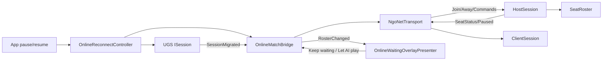

# Requirements

### Overview & Goals
Fix the online match failure where the host switched apps, got dropped, nobody became host, the turn froze, and her rejoin by code said the game was full. Afterwards, a dropped player (host or not) causes a short, visible pause, the match recovers with a working host, and the seat can be taken back by the same player, by someone on another device, or from the AI.

Follow-up issue: rejoining after the 20-second grace must reclaim the disconnected seat and resume the match; center the waiting overlay on mobile and desktop; and offer a main-menu Reconnect action for a saved unfinished match.

**Root causes found**
- `FrontEndFlow.HandleOnlineRequest` always calls `JoinByCodeAsync`. A dropped player is still a lobby member until the lobby's *Disconnect Removal Time* runs out, so rejoining counts as a new member and fails with `LobbyFull`. The raw SDK message is then shown unlocalized.
- Unity only promotes a new host after the lobby removes the old one. `OnlineMatchBridge.RestoreMigratedHost` silently returns when no migration record was uploaded yet (uploads happen on a timer). Nobody owns `HostSession`, so nothing ticks and the turn never advances.
- Clients only post a "host disconnected" notice. There is no recovery state, no timeout and no reconnect.
- Suspending the app: desktop already has `runInBackground: 1`. On iOS/Android the OS suspends the app and Relay drops it within seconds, so this can't be fully prevented. It can be absorbed with an *Away/Reconnecting* grace period and an automatic reconnect on resume.

### Scope
**In scope**
- Seat presence states: Connected, Reconnecting (grace), Disconnected, AI-controlled, Empty.
- About 20 s grace with the match frozen, then a waiting screen that shows the room code and each seat's status.
- Automatic reconnect when the app resumes, and a reconnect-first rejoin from the menu.
- Any joiner can claim a Disconnected or AI-controlled seat.
- Reliable host takeover: the new host gets **Keep waiting** or **Let AI play** for each absent seat.
- AI hand-back at the next turn start, with a "Please wait" message for the joiner.
- Localized error mapping for join failures.

**Out of scope**
- Keeping a suspended mobile app's socket alive (would need native background tasks).
- Cloud Code shared snapshot storage, and the "Paused games" menu.
- Live multi-device soak testing (still manual).

### User Stories
- As a player who switches apps briefly, I want my seat kept and to reconnect automatically when I come back, so I don't lose my game.
- As a remaining player, I want the match to pause and show who is missing and the room code, so I know what's happening and can share the code.
- As a player whose host dropped, I want to become host automatically and choose to wait or let AI play, so the game never freezes.
- As a player on a different device, I want to join with the room code and take over a disconnected or AI-controlled seat.
- As a player taking a seat back from the AI, I want a "Please wait" message until the AI finishes its turn.

### Functional Requirements
1. **Grace**: when a seat's connection drops, or the client reports it is going to the background, the seat becomes *Reconnecting*. All turn timers and bot moves freeze, input is blocked, and a compact banner shows "{name} is reconnecting… {seconds}s". Default grace is 20 s.
2. **Waiting screen**: when grace expires, the seat becomes *Disconnected* and a full overlay appears for everyone. It shows the room code, each seat (name, Host badge, status: Connected / Reconnecting / Disconnected / AI playing / Waiting for AI), and a Leave button. The host also sees **Keep waiting** and **Let AI play for {name}** for each absent seat; existing Save & pause stays available. The match resumes automatically when no blocking absence remains.
3. **Reclaim by same account**: a player who rejoins with the same auth ID gets their seat back, whether through auto-reconnect, rejoin by code or reconnect from the menu. This works during grace, after grace, and when the AI is playing the seat.
4. **Claim by a new account**: a joiner with an unknown auth ID takes the first *Disconnected* or *AI-controlled* human seat, then any Empty seat. Seats still in grace are reserved for their owner. If no seat qualifies, the joiner gets the localized message "This match has no free seats".
5. **Stale lobby slots**: when a seat becomes *Disconnected*, the host removes that player from the UGS lobby. This frees the slot so another device can join by code; the original player can still rejoin by code with their auth ID.
6. **Host loss**: clients show "Host disconnected, finding a new host…" with the match frozen. The promoted host restores from the migration record and marks all other seats *Reconnecting*. The old host's seat follows rules 1–2. If no host is restored within 45 s, show "Couldn't recover the match" with a Leave button.
7. **AI hand-back**: if it isn't the AI-controlled seat's turn, control passes to the human immediately. Otherwise the seat is marked *Waiting for AI*, the joiner sees "Please wait, the AI is finishing this turn", and control passes when the turn ends.
8. **Suspend**: going to the background never calls leave or disconnect. Coming back reconnects automatically if the connection dropped, as a client if another player became host meanwhile.
9. All new player-facing text uses `UI` table keys under `net.*`. Network messages carry enums or keys, never text.

### Non-Functional Requirements
- `Mejnun.Net` stays engine-free and fully covered by EditMode tests.
- Wire protocol is versioned (`mejnun.session.v2`). `SessionRecordCodec` reads v1 records.
- No hidden-hand leaks: claimers receive only `WriteForSeat` snapshots for their own seat.

# Technical Design

### Current Implementation
- `Mejnun.Net/HostSession.cs` keeps a private `Seat` class with `Connected` and `IsBot`. `Join` reclaims by auth ID or takes an empty seat; otherwise it returns "No open seats". `Disconnect` applies `DisconnectChoice` (Wait = turns keep auto-timing out). `Tick` runs bots and the turn timer.
- `Mejnun.Net.Unity/OnlineMatchBridge.cs` (about 730 lines) wires `HostSession`/`ClientSession` to `NgoNetTransport`. It shows a host-only disconnect prompt built in C# with inline styles, and handles `SessionMigrated` via `RestoreMigratedHost` (silently skipped when `migrationRecord == null`).
- `NgoNetTransport` maps NGO client IDs to auth IDs and raises `PlayerDisconnected` / `HostDisconnected`.
- `UgsOnlineService` creates and joins sessions with `.WithHostMigration(MigrationHandler)` using default upload intervals. There is no reconnect API usage.
- `HudPresenter.UpdateOnlineWaiting` shows `MatchFlow.OnlineWaitingMessage` in the single `online-waiting` label in `Hud.uxml`.
- `PausedMessage.Reason` sends raw English text, which breaks the localization rule.

### Key Decisions
- **Roster core plus controllers** (chosen). A pure-C# `SeatRoster` owns presence, grace and claim rules. `OnlineReconnectController` owns app lifecycle and session reconnect. `OnlineWaitingOverlayPresenter` owns the UI. `OnlineMatchBridge` only wires them together.
- **Freeze during grace, then pause** (chosen). Any blocking absence (Reconnecting or Disconnected human seat with no AI) stops the turn timer and bot moves.
- **AI hand-back at next turn start** (chosen), with a `PendingHandBack` flag broadcast so the joiner sees "Please wait".
- **Reconnect-first rejoin**: try `MultiplayerService.ReconnectToSessionAsync(sessionId, options)` using the last session ID (saved to PlayerPrefs `online.lastSessionId`), then fall back to `JoinByCodeAsync`. The host also removes Disconnected members from the lobby so join-by-code never hits `LobbyFull`.
- **Faster, safer migration**: upload interval of 2 s via the `WithHostMigration(handler, interval, timeout)` overload. Restore falls back to `MigrationHandler.RestoredRecord`. Missing data produces an explicit failure state instead of silently skipping. Document the recommended lobby dashboard config: Disconnect Host Migration Time about 5 s, Disconnect Removal Time about 60 s.
- **Keys, not text, on the wire**: `PauseReason` and `JoinRejectReason` enums replace free-text reasons.

### Data Models / Contracts
```csharp
// Mejnun.Net
public enum SeatPresence : byte { Empty, Connected, Reconnecting, Disconnected, BotControlled, Bot }
public enum PauseReason : byte { None, WaitingForPlayers, HostAway, SavedByHost }
public enum JoinRejectReason : byte { NoFreeSeat, NotSessionMember, MissingAuthentication }

public sealed class SeatRoster            // engine-free; owned by HostSession
{
    public const double DefaultGraceSeconds = 20;
    public int Claim(string authId, string name, int currentSeat, out bool pendingHandBack); // -1 = reject
    public void MarkAway(string authId);          // Connected -> Reconnecting
    public void MarkDropped(string authId);       // Connected -> Reconnecting
    public void SetBotControl(int seat, BotDifficulty d); // Disconnected -> BotControlled
    public void CompleteHandBacks(int currentSeat);       // at turn change
    public IReadOnlyList<int> Tick(double dt);    // returns seats that expired to Disconnected
    public bool HasBlockingAbsence { get; }
    public SeatState Get(int seat);              // presence, authId, name, difficulty, pendingHandBack, graceRemaining
}

// messages (NetCodec, channel "mejnun.session.v2")
SeatStatusMessage(int seat, string authId, string name, SeatPresence presence, bool pendingHandBack, float graceRemaining)
PausedMessage(PauseReason reason)                 // replaces (bool, string)
RejectedMessage(JoinRejectReason? code, string debugReason) // debugReason is log-only
AwayMessage()                                     // client -> host, sent from OnApplicationPause(true)

// SeatRecord gains Presence + PendingHandBack; SessionRecordCodec Version = 2, reads v1 (Connected->Reconnecting)
```
`HostSession` keeps its public API. `Join` delegates to `SeatRoster.Claim`; `Disconnect`/`ResolveDisconnect` map to `MarkDropped`/`SetBotControl`. `Tick` calls `roster.Tick` first, raises `SeatExpired` (the bridge uses it to remove the lobby member), and skips timers and bots while `HasBlockingAbsence`. `ApplyGroup` calls `CompleteHandBacks` when the seat changes. `IsPaused` becomes `PauseReason != None`.

### Architecture Diagram

Presence changes flow from `SeatRoster`, through `HostSession` seat-status broadcasts and the transport, to every client's `OnlineMatchBridge`. The bridge exposes a `RosterChanged` view model to the overlay presenter. Host actions go back through bridge methods. The reconnect controller sits beside the bridge, watches app lifecycle and session state, and re-runs `ConfigureClient`/`ConfigureHost` after a reconnect or migration.

### File Structure
- `Assets/_Project/Scripts/Net/`
  - **new** `SeatRoster.cs`, `SeatPresence.cs` (enums `SeatPresence`, `PauseReason`, `JoinRejectReason`)
  - modified `HostSession.cs`, `ClientSession.cs`, `NetMessages.cs`, `NetCodec.cs`, `SessionRecord.cs`, `SessionRecordCodec.cs`, `LoopbackNetwork.cs` (add drop/away/rejoin helpers)
- `Assets/_Project/Scripts/Net/Unity/`
  - **new** `OnlineReconnectController.cs` (MonoBehaviour added next to the bridge): `OnApplicationPause`, resume check, `ReconnectToSessionAsync` then join by code, 45 s host-recovery timeout, PlayerPrefs `online.lastSessionId` / `online.lastSessionCode`
  - modified `OnlineMatchBridge.cs`: remove the C#-built prompts; add `RosterChanged`, `KeepWaiting(seat)`, `LetAiPlay(seat)`, `LocalPendingHandBack`, host-recovery state; robust `RestoreMigratedHost`; remove the lobby member on `SeatExpired`
  - modified `NgoNetTransport.cs`: channel v2, `AwayMessage`, re-join after reconnect, reject with `JoinRejectReason`
  - modified `UgsOnlineService.cs`: `ReconnectAsync(sessionId)`, `RemovePlayerAsync(id)`, migration interval of 2 s, saved last-session info
- `Assets/_Project/Scripts/UI/`
  - **new** `OnlineWaitingOverlayPresenter.cs`, `Uxml/OnlineWaitingOverlay.uxml`, `Uss/online-waiting-overlay.uss`
  - modified `HudPresenter.cs` (create and bind the presenter), `Uxml/Hud.uxml` (overlay instance), `FrontEndFlow.cs` (reconnect-first join; map `SessionException`/`LobbyExceptionReason` to `online.status.*` keys)
  - `Mejnun.UI.asmdef`: add a reference to `Mejnun.Net` (for the enums)
- `Assets/_Project/Localization/Tables/*`: new `net.*` / `online.status.*` keys
- `Docs/M7-Online-Spike.md`, `Docs/Mejnun-Plan.md` §4.4: new behavior and the lobby dashboard config

### Risks
- **Migration data missing** (host lost before the first upload): mitigated by the 2 s interval and an explicit "Couldn't recover" state. Recovery can't fully succeed without hands, by design.
- **Old host returns after migration**: her session reports she's no longer host. The controller tears down the host role and reconnects as a client; her seat is reclaimed by auth ID.
- **Race between reclaim and claim**: claims are serialized on the host. Grace seats are reserved for the owner, so a new device only wins after expiry.
- **Lobby removal vs. reconnect**: once removed, `ReconnectToSessionAsync` fails, so the code falls back to join by code (the slot is free by then).
- **Wire format change**: old builds can't talk to new ones. The channel name bump makes the mismatch explicit instead of a decode crash.

# Testing

### Validation Approach
Pure-C# behavior is covered by EditMode tests in `Assets/_Project/Tests/EditMode/Net/` using `LoopbackNetwork` (extended with drop/away/rejoin). Unity wiring is checked by compiling and running the existing EditMode/PlayMode suites. Localization is validated with the `Mejnun.Localization.Tests` EditMode tests (no `RawString`, `UnknownKey`, `EmptySource`). Live UGS/Relay host-kill and suspend tests can't be run by the agent; they are listed as a manual checklist in `Docs/M7-Online-Spike.md`.

### Key Scenarios
- A drop puts the seat in Reconnecting: `Tick` doesn't advance the turn timer or bots, and seat status is broadcast with `graceRemaining`.
- Rejoining with the same auth ID within grace restores Connected, sends a Welcome with the own-seat snapshot, and lets the match continue.
- Grace expiry gives Disconnected, raises `SeatExpired`, and broadcasts `PausedMessage(WaitingForPlayers)`.
- A new auth ID joining after expiry claims the Disconnected seat, the seat's auth ID and name update, and the match resumes.
- A new auth ID joining during grace is rejected with `NoFreeSeat` when no other seat qualifies.
- `LetAiPlay` gives BotControlled and the game resumes with the bot playing.
- Joining a BotControlled seat that isn't the current seat hands over immediately.
- Joining while the AI seat is the current seat sets `pendingHandBack = true`; the bot finishes the turn, then the seat becomes Connected.
- `AwayMessage` marks Reconnecting immediately, without waiting for a transport drop.
- Migration restore: `FromRecord` plus re-host marks all other seats Reconnecting, and the old host's seat expires into the waiting state.

### Edge Cases
- `SessionRecordCodec` reads v1 records (Connected maps to Reconnecting) and round-trips v2.
- `NetCodec` round-trips the new `SeatStatus`, `Paused`, `Rejected` and `Away` messages and rejects unknown enum values.
- Two joiners racing for one Disconnected seat: the first wins, the second is rejected.
- An original player returning after their seat was claimed gets another qualifying seat or `NoFreeSeat`.
- Save & pause still works and resume clears `PauseReason`.
- Language change re-renders overlay text (presenter subscribes to `Loc.LanguageChanged`).

### Test Changes
- **New** `SeatRosterTests.cs` (state machine, claims, grace, hand-back).
- Update `HostSessionTests.cs`: `Host_DisconnectedSeatCanBeTakenOverByBot`, `Host_ReconnectRestoresSeatAndSnapshot`, `Host_SeatStatusChangesTrackConnectionsAndReadiness`, `Host_SavePauseAndMigrationRestoreTheSession` and the codec tests for the new contracts. Add freeze, claim, hand-back and migration-marking tests.

# Delivery Steps

### ✓ Step 1: Add SeatRoster presence core and integrate it into HostSession
The engine-free host tracks Reconnecting, Disconnected and AI-controlled seats, freezes the match while anyone is absent, and handles claims and AI hand-back, all covered by EditMode tests.

- Add `SeatPresence`, `PauseReason` and `JoinRejectReason` enums plus `SeatRoster.cs` in `Assets/_Project/Scripts/Net/`: grace timers (20 s default), claim rules (same auth anywhere; new auth only Disconnected/BotControlled, then Empty), `SetBotControl`, `CompleteHandBacks`, `HasBlockingAbsence`.
- Refactor `HostSession` to delegate to the roster:
  - `Join` calls `Claim`, with the pending hand-back used when the AI seat is current.
  - `Disconnect` calls `MarkDropped`; add `MarkAway`.
  - `ResolveDisconnect` maps Wait to keep waiting and TakeOverWithBot to `SetBotControl`.
  - `Tick` runs the roster first and raises `SeatExpired`; timers and bots are skipped while absent.
  - `ApplyGroup` completes hand-backs at turn change.
  - The pause reason is broadcast automatically.
- Update `NetMessages`/`NetCodec`: `SeatStatusMessage` with presence, pendingHandBack and graceRemaining; `PausedMessage(PauseReason)`; `RejectedMessage` with `JoinRejectReason`; new `AwayMessage`.
- Update `ClientSession` to handle the new messages and expose presence and pause reason.
- Extend `SeatRecord`/`SessionRecordCodec` to v2 (presence, pendingHandBack) with v1 read support.
- Extend `LoopbackNetwork` with drop/away/rejoin helpers.
- Add `SeatRosterTests.cs` and update `HostSessionTests.cs` for grace, freeze, claims, hand-back, migration marking and codec round-trips; run the Net EditMode tests.

### ✓ Step 2: Make host loss and stale lobby slots recover in the Unity bridge
When the host or a client drops, the transport and bridge follow the roster, the promoted host reliably takes over, and stale lobby slots are freed.

- `NgoNetTransport`:
  - Bump the channel to `mejnun.session.v2`.
  - Route `AwayMessage` to `HostSession.MarkAway`.
  - Reply with `RejectedMessage(JoinRejectReason)`.
  - Allow re-join from a new NGO client ID for the same auth ID after reconnect.
- `UgsOnlineService`:
  - Use `WithHostMigration(handler, 2 s, timeout)`.
  - Add `RemovePlayerAsync(playerId)` (host) and `ReconnectAsync(sessionId)` wrapping `MultiplayerService.ReconnectToSessionAsync`.
  - Save the last session ID and code to PlayerPrefs.
- `OnlineMatchBridge`:
  - Subscribe to `HostSession.SeatExpired` and remove that member from the lobby.
  - Expose a `RosterChanged` view model, `KeepWaiting(seat)`, `LetAiPlay(seat)` and `LocalPendingHandBack`.
  - Make `CanControlSeat` false while hand-back is pending.
  - `RestoreMigratedHost`: fall back to `MigrationHandler.RestoredRecord`, mark other seats Reconnecting, and enter an explicit failure state when no record exists.
  - On a client, `OnHostDisconnected` enters a "finding new host" state.
  - Add warning logs around migration and reconnect.
- Delete the C#-built `ShowDisconnectPrompt`/`ShowPausedPrompt` (replaced by the overlay in a later stage).

### ✓ Step 3: Add OnlineReconnectController and reconnect-first menu rejoin
Suspending the app never leaves the match, coming back reconnects automatically (as a client if someone else became host), and rejoining from the menu reuses the existing lobby membership.

- New `Assets/_Project/Scripts/Net/Unity/OnlineReconnectController.cs`, added next to `OnlineMatchBridge`:
  - `OnApplicationPause(true)`: a client sends `AwayMessage`; the host broadcasts `PausedMessage(HostAway)`. Never leave the session.
  - On resume, check NGO and session state. If dropped, try `ReconnectAsync(sessionId)`, then fall back to `JoinByCodeAsync(code)`.
  - If the local player is no longer host, tear down the host role and call `ConfigureClient` with a new `ClientSession` so the seat is reclaimed by auth ID.
  - Start a 45 s host-recovery timeout that leads to the "Couldn't recover the match" state.
- `FrontEndFlow.HandleOnlineRequest` (JoinByCode): if the code matches the saved last session, or the session ID is in the joined sessions, reconnect first, then join by code.
- Map `SessionException`/`LobbyExceptionReason` (e.g. `LobbyFull`, not found) to localized `online.status.*` keys instead of `exception.Message`.

### ✓ Step 4: Build the localized waiting overlay and host choices
Players see a localized Reconnecting banner, a full waiting screen with the room code and per-seat status, host Keep waiting and Let AI play actions, and a Please wait message during AI hand-back.

- New `Uxml/OnlineWaitingOverlay.uxml` and `Uss/online-waiting-overlay.uss`. Static labels are bound via `LocalizedString` (`UI` table); C#-set elements have no literal.
- New `OnlineWaitingOverlayPresenter.cs` in `Mejnun.UI`:
  - Subscribe to `OnlineMatchBridge.RosterChanged`.
  - Render the room code, seat rows (name, Host badge, status, grace countdown), the compact grace banner, host-only buttons and the Leave button.
  - Show the "Please wait, the AI is finishing this turn" panel when `LocalPendingHandBack` is set, and the "finding new host" and "couldn't recover" states.
  - Re-render on `Loc.LanguageChanged`.
- Hook the presenter into `HudPresenter`/`Hud.uxml`; add a `Mejnun.Net` reference to `Mejnun.UI.asmdef`.
- Add the new `net.waiting.*`, `net.seat.status.*`, `net.host.*`, `net.handback.*` and `online.status.*` keys via CSV import (English plus context comments).
- Run `Mejnun.Localization.Tests` and the full EditMode suite.

### ✓ Step 5: Update docs and lobby configuration notes
The design docs describe the new disconnect, reconnect and host-takeover behavior, along with the required UGS dashboard settings and a manual live-test checklist.

- `Docs/Mejnun-Plan.md` §4.4: replace the disconnect section with grace, waiting screen, seat claiming, AI hand-back and host takeover rules.
- `Docs/M7-Online-Spike.md`:
  - Document the 2 s migration interval.
  - Add the recommended lobby config (Disconnect Host Migration Time about 5 s, Disconnect Removal Time about 60 s).
  - Note the reconnect-first join and the protocol v2 bump.
  - Add a manual checklist: host app-switch, client app-switch, host kill, rejoin from a new device, AI hand-back mid-turn.

### ✓ Step 6: Accept late joins after grace expiry
Queue a join request while UGS membership refreshes after the disconnected player is removed; accept it once the lobby recognizes the member and reject it after a bounded deadline. Refresh pause state before sending the join response so a reclaimed seat does not receive stale WaitingForPlayers state.

- Add engine-free `PendingJoinGate` with accept, expiry, replacement, and client-disconnect behavior and EditMode tests.
- Update `NgoNetTransport` to gate not-yet-visible membership, refresh UGS membership every 2 seconds, retry `NotSessionMember` client joins with a bounded retry count, and remove pending requests on disconnect.
- Update `HostSession.Join` to refresh presence/pause state before sending join messages; test same-auth rejoin after grace and a new claimant after expiry.

### ✓ Step 7: Recover dropped clients automatically
Detect a client that remains disconnected after a transient drop and run the existing reconnect-first recovery flow, without overlapping migration or reconnect attempts.

- Add the 10-second disconnected watchdog and 10-second retry cadence to `OnlineReconnectController`.
- Clear recovery state after successful client reconfiguration and validate the recovery path.

### ✓ Step 8: Center the waiting overlay on every device
Make the waiting overlay cover the HUD viewport and center its content consistently on mobile and desktop.

- Give the overlay instance in `Hud.uxml` absolute full-screen positioning and ignore pointer picking on the root instance.
- Verify the resulting hierarchy/style against existing overlay conventions.

### ✓ Step 9: Add a persistent main-menu Reconnect action
Persist whether an online match is unfinished, show a localized action with its saved room code, and let the player reconnect through the existing reconnect-first join path.

- Add `online.unfinishedMatch` helpers in `UgsOnlineService`; mark on match start and clear on match finish or when the session is gone, but preserve it on deliberate Leave.
- Add a reconnect button to `FrontEnd.uxml`; bind visibility and localized text from `MainMenuScreen` and connect it through `FrontEndFlow`.
- Add `menu.main.reconnect`, `online.status.reconnecting`, and `online.status.match_ended` UI table entries through CSV import.

### ✓ Step 10: Validate late rejoin and localization
Run focused networking and localization EditMode tests, including the new gate and the late-rejoin regression scenarios.

- Run `Mejnun.Net.Tests` and `Mejnun.Localization.Tests`; inspect actual XML results and `git diff --check`.

### ✓ Step 11: Rejoin through a clean UGS session
Make the main-menu reconnect path remove any stale local session before joining by code, and ensure a former host rejoins as a client rather than starting an empty host.

- Add `UgsOnlineService.RejoinByCodeAsync(code, properties)`: best-effort leave, wait up to 5 seconds for the SDK session registration to clear, then join by code.
- Update `FrontEndFlow.HandleOnlineRequest` to use that path when reconnecting as a former host before migration has completed.

### ✓ Step 12: Handle replacement NGO clients and pending joins
Allow the new client connection for an authentication ID to replace a stale NGO mapping and retain membership-gated join behavior.

- Add `PendingJoinGate.ContainsAuthentication`.
- Add `NgoNetTransport.HasActivePlayer`; prefer the newest connection for duplicate auth IDs, clean up old mappings and disconnect the stale NGO client.

### ✓ Step 13: Recover membership loss and publish accurate roster state
Avoid removing a player who is already reconnecting, and retry client reconfiguration after membership loss or a missing Welcome without overlapping recovery attempts.

- Update `OnlineMatchBridge` to skip lobby removal for active/pending players, guard own rejoin removal events, expose whether it is awaiting Welcome, and publish disconnected host status plus fallback display names.
- Update `OnlineReconnectController` to rejoin by code after membership loss or a 20-second missing-Welcome watchdog, with 20-second retry cadence.

### ✓ Step 14: Show seat names in the waiting overlay
Ensure seat names are visibly styled beside their status and host badge.

- Add the `online-seat-name` class to the generated label and set its layout sizing in the overlay stylesheet.

### ✓ Step 15: Verify reconnect and roster fixes
Run focused networking and localization checks and compile the Unity networking/UI assemblies.

- Add coverage for `PendingJoinGate.ContainsAuthentication` and run `Mejnun.Net.Tests` and `Mejnun.Localization.Tests`.
- Build `Mejnun.Net.Unity.csproj` and `Mejnun.UI.csproj`; run `git diff --check`.

### ✓ Step 16: Preserve membership and recover reliably after host loss
Keep clients in the UGS lobby while host migration is pending, allow enough time for UGS promotion, and preserve the latest valid migration snapshot so the match can recover.

- While awaiting host migration, refresh the session periodically and suppress reconnect watchdog paths that leave the lobby; reconnect by session ID only during this state.
- Extend the recovery timeout beyond UGS's default host migration delay and continue showing the missing host as Disconnected after a failed recovery attempt.
- Preserve lobby membership through `ReconnectAsync`; Unity Multiplayer 2.5.0 does not expose host-migration configuration on `ReconnectSessionOptions`. Cache/retain the last non-empty migration record when no authoritative session is available.
- Document the required UGS lobby dashboard migration/removal settings; run networking tests and compile the affected Unity assemblies.