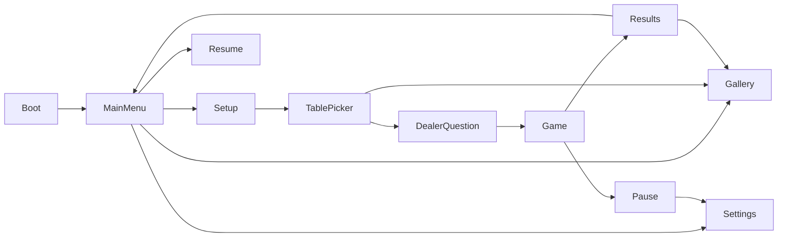

# Requirements

### Overview & Goals
Update `Docs/Mejnun-Plan.md` (a docs-only change) so the plan covers the front end of the game:
- a **main menu**
- a **Settings** screen opened from the main menu
- a **deck picker** and a **board-background picker** before a game starts
- a **Gallery** of unlocked and locked decks and board backgrounds, showing what unlocks each locked item.

The new rules must fit the existing cosmetics rules (§3.6) and online rules (§4). All of the work goes into **M6 Cosmetics & progression**.

### Scope
**In scope**
- New front-end section covering the screens, how you move between them, and their layout.
- Rewrite of the §3.6 face rule: players now **pick both decks**, which replaces "equipping a face isn't a thing".
- A new rule for the board background (`TableFelt`): **each player picks a preferred background, and one is drawn at random** from those picks.
- Knock-on edits to §3.2 (GameState), §3.7 (menu music/state), §4.5 (lobby/join payload), §6 (persistence), §7 (localization), §8 (settings), §9 (the M6 row), §10 (testing), §11 (decisions and open questions) and the status line.

**Out of scope**
- Any code, scene or UXML changes; this task only edits the plan document.
- Card back, avatar and shout pickers (left as possible later extras).
- Online lobby UI beyond the pick payload (that stays in M7).

### Functional Requirements (what the plan text must say)
1. **Main menu** is the boot screen. It has: Play (Solo vs AI / Pass & play → the existing setup screen), Resume (only when `SavedGame.HasSave`), Online (shown but disabled until M7), Gallery, Settings, and Quit (desktop only). It plays `Music_Menu` with `Game_Phase = Menu`, follows portrait/landscape/safe-area/RTL rules, and Esc/back moves up one screen.
2. **Settings from the main menu** opens the same settings panel as the in-game pause menu: one shared component, with the same `GameSettings` keys. Categories are Gameplay & confirmations, Hints, Accessibility (reduced motion, haptics), Audio (volume sliders driving `Volume_*` RTPCs), Language, Online (quick-match bot fill), and Account / Restore purchases (mobile). Changes save immediately.
3. **Pre-game pickers** sit in a "Table" step of setup, after seats and timer and before Start:
   - **Decks**: two slots. Each slot takes an *unlocked* face or **Random**, and the two slots must be different faces.
     - Solo and pass-and-play: the picks are used directly (slot 1 → `Deck 0`, slot 2 → `Deck 1`).
     - Online: each human's two picks are combined into one pool, and the host draws two different faces from it with the seeded RNG.
     - A Random slot resolves to an owned face; in solo, bots may add catalogue faces to Random slots (Q-E).
   - **Board background**: one slot, unlocked felt or Random. Each human's pick is a preference, and the background is drawn at random from the preferences (pass-and-play makes a single pick for the shared device). The result is stored in game state so every client and replay agrees.
   - Locked items appear greyed with a lock and link to their Gallery entry. The last picks are remembered.
4. **Gallery** has a Decks tab and a Board backgrounds tab:
   - Unlocked items show a preview: a sample hand fan for decks, a swatch for felts.
   - Locked items show a dimmed preview with the requirement text from `UnlockRequirement` (level, wins, achievement, purchase) and a progress bar where progress is countable.
   - It shows owned/total counts, and a "New" badge on items unlocked since the last visit.
   - The results screen's "Not unlocked yet" badge links to the matching Gallery entry.
5. **The M6 row** in §9 lists these screens and gets a matching exit criterion. §10 gets the matching tests.
6. **Decisions log** gets new rows for the three decisions above. Q-E is reworded so it only applies to Random slots, and a new open question covers the remaining gaps.

# Technical Design

### Current Implementation (which the plan must stay consistent with)
- `MatchFlowScreen` starts at `Setup`. `MatchFlowPresenter` toggles `SetupScreen`, `DealerQuestionScreen`, `HandoffScreen` and `ResultsScreen` inside one `UIDocument` (`flow-root`). There is no main menu yet.
- Settings exist only as the HUD pause menu's `settings-panel` in `HudPresenter`, saved through the static `GameSettings` (PlayerPrefs).
- `MatchFlow` passes **every** catalog id (`DeckSkinCatalog.GetSkinIds()`, including `skin:back` variants built by `DeckFaceId.Compose`) as `GameSetup.facePool`. `MejnunGame` then calls `DeckFaceAssigner.Assign(pool, rng)`, and `DeckSkinCatalog.Resolve` falls back to Classic / Classic Ivory.
- There is no `TableFelt`, inventory or `UnlockRequirement` code yet; all of that is planned M6 work.

### Key Decisions (confirmed with the user)
| Decision | Choice |
|---|---|
| Deck picker | The player picks **both** decks (two different faces, or Random per slot). Offline the picks are used directly; online all humans' picks are combined into one pool and two faces are drawn from it with the seeded RNG |
| Board background | Each player picks a preferred background, and the table's background is **drawn at random from those picks** (seeded RNG, stored as an opaque `TableFeltId` in `GameState`/snapshot) |
| Milestone | Everything goes into **M6 Cosmetics & progression** |
| Settings | One shared settings panel, used by both the main menu and the pause menu (taken out of `HudPresenter`) |

### Proposed Changes to `Docs/Mejnun-Plan.md`
- **Status line (L3)**: mark it draft v2.3 and summarise the front-end additions.
- **§3.2 Core model**: `GameState` gains `TableFeltId` (an opaque string, like `DeckFaces`). `GameSetup` takes `DeckPicks[2]`, where null means Random, plus `FeltPool`. The snapshot version is bumped.
- **§3.6 Deck art & cosmetics**:
  - Replace the "picked uniformly at random from owned faces" and "equipping isn't a thing" bullets with the picker rule above.
  - Keep the "two decks always look different" rule and the per-deck-index fallback.
  - Add a `TableFelt` bullet: an SO with id, display name, sprite/material and `UnlockRequirement`; Green and Burgundy are free, and there is a `TableFeltCatalog`.
  - Define `UnlockRequirement` as kind + target + localized description + progress query, so the Gallery can render it.
  - Online join payload: owned face ids plus deck picks plus felt preference.
- **New §3.8 Front end (menus & gallery)**:
  - The screen map and Mermaid diagram.
  - The main menu items.
  - The shared settings panel and its categories.
  - The setup "Table" step with the pickers.
  - The Gallery layout and lock/progress display.
  - Back/Esc navigation; RTL mirroring and safe areas.
  - Classes to name: `MainMenuScreen`, `SettingsPanel`, `TablePickerScreen`, `GalleryScreen`, all in `Mejnun.UI` and driven by a new `FrontEndFlow` / `MatchFlowScreen.MainMenu` entry point.
- **§3.7 Audio**: `Music_Menu` and `Game_Phase=Menu` play on the main menu, Gallery and Settings.
- **§4.5 Online rules**: the lobby summary shows each player's picks; the host draws decks and felt at deal time.
- **§6 Persistence**: save the last deck picks, felt preference and the Gallery's "seen" set.
- **§7 Localization**: strings for the new screens and `UnlockRequirement` descriptions (Smart Strings for "Win 3 more games").
- **§8 Accessibility & settings**: settings are reachable from the main menu and the pause menu; list the categories, and move the audio bus volumes out of the "later" list.
- **§9 M6 row**: add the main menu, settings screen, deck and felt pickers, and Gallery, plus `TableFelt` and two free felts. New exit criterion: *from a cold boot a player can browse the Gallery, change settings, pick two decks and a felt, and play a game that uses them; a locked item shows its requirement and progress*.
- **§10 Testing**: Core tests for direct picks, combined online picks and seeded felt draws (including the snapshot round-trip); PlayMode tests for menu navigation, settings persistence across menu and pause, and the Gallery's lock/progress rendering.
- **§11**: add decisions 22–25 (main menu as boot screen, deck picker, felt draw, shared settings; decision 23 replaces #10) and reword Q-E. Add **Q-K**: should pass-and-play let each local human make their own felt/deck picks, or keep one pick per device (default)?

### Architecture Diagram (to be included in the new §3.8)

### Risks
- The deck picker changes a rule already recorded as decided (decision #10). The new decision row must explicitly replace it so the document doesn't contradict itself.
- Faces that a player picked online but another player doesn't own must still render, so the "all faces ship in the build" rule stays as it is.

# Delivery Steps

### ✓ Step 1: Add the front-end section: main menu and settings
The plan describes a main menu boot screen and a Settings screen opened from it, shared with the pause menu.
- Add new §3.8 *Front end (menus & gallery)* with:
  - the screen map
  - the Mermaid navigation diagram
  - the main menu items (Play, Resume, Online-disabled, Gallery, Settings, Quit on desktop)
- Describe the shared `SettingsPanel`, taken out of the `HudPresenter` settings panel and backed by `GameSettings`, and list its categories.
- Update §3.7 (menu music/state), §7 (new screen strings, RTL) and §8 (settings reachable from both menus; audio volumes now in scope).

### ✓ Step 2: Rewrite cosmetic selection rules for deck and board-background pickers
The plan specifies the pre-game Table step and the new rules for choosing decks and the board background, offline and online.
- In §3.8, add the setup "Table" step: two deck slots (different faces or Random) and one felt slot; locked items link to the Gallery; last picks remembered.
- In §3.6:
  - replace the random-owned-face and "no equipping" bullets with the pick-both-decks rule (direct offline; online picks combined and drawn with the seeded RNG)
  - add the `TableFelt` SO and `TableFeltCatalog` (two free felts) and the felt-preference random draw
  - define the `UnlockRequirement` shape
- In §3.2, add `TableFeltId` to `GameState`/snapshot and `DeckPicks`/`FeltPool` to `GameSetup`.
- Update §4.5 (join payload, lobby summary) and §6 (saved picks).
- In §11.1, add decisions 22–25 (decision 23 replaces #10), reword Q-E, and add Q-K.

### ✓ Step 3: Add the Gallery and update M6, testing and status
The plan includes the Gallery screen, and the M6 milestone, testing strategy and status line reflect all the new front-end work.
- In §3.8, describe the Gallery's Decks and Board backgrounds tabs: previews, locked dimming, requirement text, progress bars, owned/total counts, "New" badges, and the link from the results-screen badge.
- Extend the §9 M6 row's deliverables and add the cold-boot exit criterion.
- Add §10 tests: deck-pick and felt-draw determinism plus snapshot round-trip; PlayMode menu navigation, settings persistence, and Gallery lock rendering.
- Bump the status line at the top to draft v2.3, and re-read the whole document so the section references and decisions don't contradict each other.